# ADR-0001: Currency units (rial/toman)

**Status:** Open, verdict (c): unknown. Provider confirmation is required. 2026-10-27, plan 010.

Plan 012 must read this record before it compares gateway amounts with stored amounts.

## 1. Context

Iran uses two units: the rial (official) and the toman (1 toman = 10 rials). The money path
converts once and then passes the quote through without conversion:

```mermaid
flowchart LR
    UI["Logiwall-Front<br/>parcelValue (labelled rial)"] -->|"CreateOrder stores"| P["OrderParcel.ParcelValue (int)"]
    P -->|"divides by 10"| Q["MyTipax inquiry value"]
    Q -->|"returns"| R["MyTipax finalAmount (string)"]
    R -->|"decimal.Parse, stores"| O["OrderInqueryOption.FinalAmount"]
    O -->|"no conversion"| S["PaymentTokenRequestDto.Amount"]
    S -->|"casts to long, splits 60/40"| G["SEP 724 token: amount + accounts"]
```



1. The client sends `ParcelValue` per parcel (`src/Logiwall.Shared/Dtos/OrderItems/CreateOrderParcelRequestDto.cs:10`, `int`).
2. `GetOptionsAsync` sends `Value = (t.ParcelValue/10).ToString()` to MyTipax
   (`src/Logiwall.Infrastructure/Services/OrderItems/OrderService.cs:120`). `ParcelValue` is an
   `int`, so this is integer division.
3. The MyTipax response is stored without conversion:
   `FinalAmount = decimal.Parse(t.FinalAmount, CultureInfo.InvariantCulture)` (`OrderService.cs:136`),
   and the same for `ServiceAmount` (`specialService`), `Tax` and `PackagingAmount` (`packageService`).
4. `SelectOptionAndPaymentAsync` passes `Amount = orderInquiry.FinalAmount` to SEP (`OrderService.cs:250`).
5. `Sep724Provider.GetPaymentTokenAsync` truncates and splits the amount
   (`src/Logiwall.Infrastructure/Providers/Sep724Provider.cs:47-62`).

## 2. Evidence

* **Backend: one conversion only.** A search for `/ 10` and `* 10` in `src/**/*.cs` (migrations
  excluded) finds only `OrderService.cs:120`. Nothing converts the MyTipax price or the SEP amount.
* **Backend DTOs carry no unit.** `OrderInquiryOptionDto` (`src/Logiwall.Shared/Dtos/Providers/PostalService/OrderInquiryOptionDto.cs`)
  and `OrderInquiryParcelDto` have only `JsonPropertyName` attributes, with no comments about units.
  The SEP DTOs use `long Amount` (`src/Logiwall.Shared/Dtos/Providers/Sep724/GetPaymentTokenRequestDto.cs:7`,
  `GetPaymentTokenAccount.cs:5`).
* **The UI labels every amount as rial.**
  * Parcel value input and display: `Logiwall-Front/src/components/ui/numeric-format/index.tsx:56`,
    `Logiwall-Front/src/features/create-order/components/StepThree.tsx:56`.
  * Parcel value limits: 4,000,000 to 400,000,000 rial, and 10,000,000 rial for an envelope
    (`Logiwall-Front/src/features/create-order/components/StepTwo.tsx:27-31,111-113`).
  * Quote display: `baseAmount`, `taxAmount`, `pickupAmount` and `totalAmount` are shown with the
    label "ریال" (`StepEight.tsx:110-130`). `totalAmount` is the raw MyTipax `finalAmount`
    (`OrderService.cs` maps `TotalAmount = t.FinalAmount`).
  * The UI does not multiply or divide any amount by 10.
* **Runtime evidence (magnitude only, staging).** One local, untracked log file from 2024-09-29
  holds SEP token requests to the staging host (`stage.724.ir`). Their `amount` values have
  5 digits. If they are rials, the courier price is 1,000-9,999 toman, which is very low for a
  parcel. If they are tomans, the price is in the normal range. The log has no MyTipax inquiry
  responses. This evidence is from staging only, so it does not show that money moved
  incorrectly in production.

## 3. Unit per field

| Field | Unit | Confidence | Evidence |
|---|---|---|---|
| `ParcelValue` (client input) | rial | inferred | UI label and limits, `StepTwo.tsx:27-31`, `numeric-format/index.tsx:56` |
| MyTipax inquiry `value` | toman | inferred | Code divides the rial value by 10, `OrderService.cs:120` |
| MyTipax `finalAmount` | unknown (toman likely) | unknown | No DTO comment; if `value` is toman, the price is probably toman too; staging magnitudes fit toman |
| MyTipax `specialService` (`ServiceAmount`) | same as `finalAmount` | unknown | Same response object |
| MyTipax `tax` | same as `finalAmount` | unknown | Same response object |
| MyTipax `packageService` (`PackagingAmount`) | same as `finalAmount` | unknown | Same response object |
| SEP token `amount` | rial (usual for Iranian bank gateways) | unknown | Not documented in the repo; operator must confirm |
| SEP `accounts[].amount` (split) | same as SEP `amount` | unknown | Derived from `amount`, `Sep724Provider.cs:48-62` |

The UI shows the MyTipax price with a rial label. If MyTipax quotes in toman, the UI shows
one tenth of the real price **and** SEP charges one tenth.

## 4. Verdict

**(c) Unknown: provider confirmation is required.**

The code is consistent only if MyTipax expects `value` in toman but returns prices in rial.
That is possible but unusual. The likely case (toman in both directions, rial at SEP) is a
mismatch: SEP would charge one tenth of the price. Plan 012 must not compare or convert
amounts until the operator answers the questions below. After the answers, change this
verdict to (a) or (b), and plan 012 adds the conversion and its unit tests.

## 5. Questions for the operator/provider

1. Does MyTipax `/api/v1/orders/inquiry` expect the parcel `value` in tomans?
2. Does the MyTipax inquiry response express `finalAmount`, `specialService`, `tax` and `packageService` in rials or tomans?
3. Does SEP 724 `token` accept `amount` (and `accounts[].amount`) in rials?
4. Was any production payment made through SEP? If yes, does its charged amount equal the quoted price, or one tenth of it?
5. Should the account split use `MyTipaxShare`, or the remainder after `LogiwallShare` (the current code)?
6. Is Logiwall's share really 60% of the courier price (`LogiwallShare = 60`, `MyTipaxShare = 40` in `20240924213908_AddAccountInfoInAppSettings.cs:15,19`)?
7. Is rounding (instead of truncation) acceptable to the gateway, and must the account amounts add up exactly to `amount`?
8. Should the parcel value keep integer division (it drops the last rial digit), or must it reject values that are not multiples of 10?

## 6. Split rule

Current formula (`Sep724Provider.cs:47-62`):

```text
amount        = (long)FinalAmount                    -- truncates the decimal part
logiwallShare = amount * LogiwallShare / 100         -- integer division, truncates
myTipaxShare  = amount - logiwallShare               -- MyTipax gets the remainder
```

* The `(long)` cast drops any decimal part of the quote.
* The integer division rounds Logiwall's share down, so MyTipax receives the rounding remainder.
* `MyTipaxShare` is seeded (`AddAccountInfoInAppSettings.cs:19`) and exposed on `AppSettingsDto`,
  but no code reads it.
* The two account amounts always add up to `amount`.

Worked example with a made-up quote of `125,999.75` and `LogiwallShare = 60`:

```text
amount        = 125,999
logiwallShare = 125,999 * 60 / 100 = 7,559,940 / 100 = 75,599   (75,599.4 truncated)
myTipaxShare  = 125,999 - 75,599   = 50,400
```

The customer pays 125,999 (0.75 is lost), Logiwall receives 75,599 and MyTipax receives 50,400.
