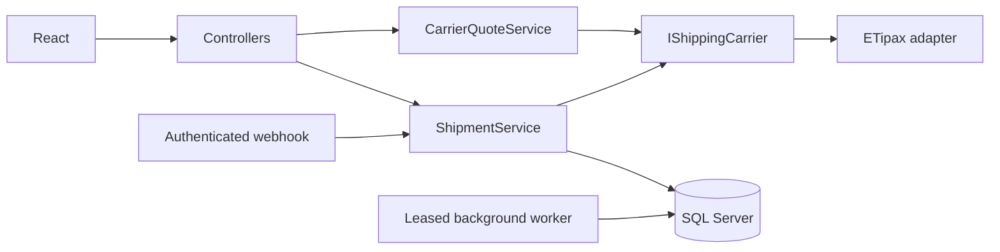

# ADR 0006: Carrier shipments and provider reference data

Accepted 2026-11-03.

Keep the existing layered application. Each active carrier implements `IShippingCarrier` in Infrastructure.
Application owns the contract. ShipmentService owns the order-to-carrier workflow. Controllers do not call carrier HTTP APIs.
MyTipax is removed from runtime DI. Its historical codes, records and legacy test support remain readable.

Internal city IDs remain stable. `StaticDataMappers` stores separate provider codes; ETipax is enum value 1.
The initial ETipax city snapshot comes from ShopLink. Province names disambiguate equal city names.
Packaging, contents and status definitions are scoped by ServiceProviderId and category in ProviderReferenceItems.
Adding a carrier requires its adapter, city mapping type, reference metadata rules and settlement policy.
Do not assume that another carrier accepts ETipax reference codes or payment mode numbers.

One shipment per Logiwall order freezes the selected quote's exact registration request.
An attempt is saved before network I/O. Parallel registration uses an order row lock and a unique shipment index.
Unknown outcomes and incomplete tracking codes require operator investigation. Neither a timeout nor process restart causes automatic resubmission.
User-authorized recovery (2026-11-06): a definitively Rejected shipment may be edited, re-quoted and explicitly registered again. Reuse the shipment identity and preserve every attempt; replace parcel links and the request snapshot only before the next submission. Submitting/Unknown and any previously accepted shipment (including Cancelled) remain locked. Only carrier acceptance finalizes shipping; quote selection and payment do not. Edits invalidate all quotes and selections. Compare the form modification timestamp after carrier pricing under the order lock to reject stale quotes. Payment records remain intact.

Carrier parcel status is separate from Orders.State and PaymentStatus. OrderStatuses retains applied carrier events,
and ShipmentEvents retains unique received events, including older events not applied.
Duplicate webhook deliveries succeed without inserting another event.
Older event IDs cannot roll back a parcel. Unmatched events are retried fairly using LastReconciledAt.

Two SQL-backed leases protect catalogue sync and webhook reconciliation across replicas.
The confirmed ParcelStatus API returns definitions. No per-shipment polling API is known. A polling job must wait for that contract.

The existing frontend uses kilograms and rials. This adapter preserves values and never guesses a factor of 10 or 1000.
ADR 0001 still requires provider confirmation of monetary units before real monetary operations.
PaymentMethod 71/72 is shared across carriers and is selected before quotation. It is frozen on the accepted quote.
The client loads service types separately, selects an internal serviceReferenceId and payment method, then explicitly asks for a price.
No pickup slots are generated, returned or required. Price confirmation does not assign a pickup timestamp.
Historical nullable PickupDateTime values remain readable; the current flow does not schedule collection.
Quotation validates that active provider-scoped reference and calls only its carrier/service. It does not enumerate and price the catalogue.
The ETipax adapter maps online to 10 and carrier collection to 20 (ShopLink's payment seed); pickup/distribution are both 10.
Online registration requires verified sufficient payment. Carrier-collected quotes require no online payment and cannot be charged online.
Neither path fabricates a successful payment. The adapter validates the snapshot's mode against the shared method before submission.
The user authorized registration with all eight mapped methods: 72-78 settle through the carrier, including wallet and credit options.
Their account eligibility is decided by ETipax. Online method 71 retains backend verification; no synthetic paid state is recorded.
ProviderReferenceItems category service contains 13 ETipax services seeded from ShopLink with source provenance;
the remote catalogue job updates packaging/content/status only and preserves service references.

Raw snapshots contain personal data and are stored for operations only. Customer endpoints return tracking/status DTOs, not raw payloads.

Unified lifecycle (user decision, 2026-11-06): Orders.OverallStatus is the customer-facing general status, independent of legacy payment/selection Orders.State. ProviderReferenceItems(category=status).MappedOrderStatus stores provider-scoped mappings, preserving the original external code/title and metadata. ShipmentParcels retains raw carrier status and its mapped status; received history retains both. Aggregate delivery requires all parcels delivered. Unmapped codes require review and remain stored. Shipment.State remains an internal operation/idempotency guard, exposed explicitly as operationState; the legacy state response field is compatibility only. Shipment statusCode/statusTitle expose the carrier status. New carriers supply their definitions and mappings; numeric provider codes never become general order IDs.

2026-11-06 simplified public lifecycle (user correction): all pre-acceptance stages display Incomplete=0 (Draft code). Accepted and awaiting-carrier-confirmation map to Registered=10. Public statuses 1/2/3/4/11/23/24 are retired and normalized by SimplifyPublicOrderStatuses; operation guards are unchanged. Multi-parcel orders show the outstanding parcel stage until all are delivered; original parcel statuses remain available. Unmapped codes retain the last known general stage.

No-packaging selection (2026-11-06): PackageTypeId=0 allows a null PackagingReferenceId. The Tipax quote path resolves carrier-defined records 504/521 by the selected content's packType. Do not send an invented zero packing ID. Reject incompatible or inactive references before pricing; freeze the resolved values in the registration snapshot. Packaging catalogue rows expose requiresPackaging so clients do not hardcode carrier IDs.
