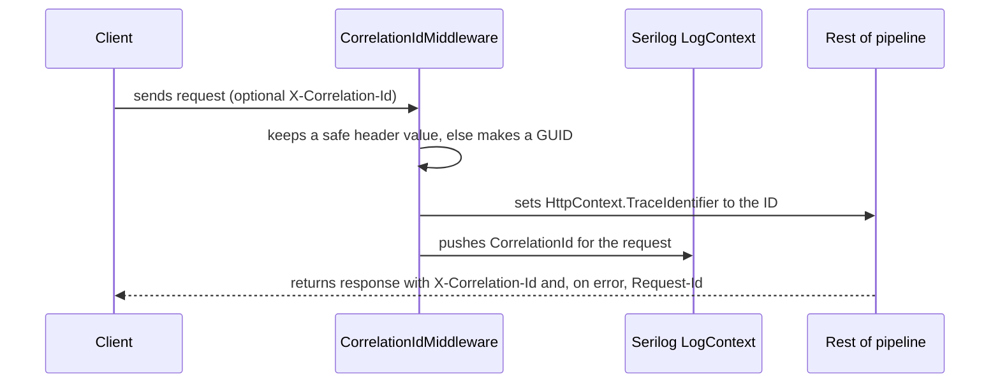

# Cycle 017 — Persian client messages, structured logs, open items: spec

## Contents

- L49 1. Glossary
- L63 2. Goals and non-goals
  - L65 Goals
  - L74 Non-goals
- L91 3. Requirements
  - L95 3.1 Client messages (decision ADR-0003)
  - L109 3.2 Logs (decision ADR-0004)
  - L122 3.3 Durable decisions
  - L131 3.4 Open items
  - L155 3.5 Non-functional requirements
- L167 4. Design: client messages
  - L169 4.1 Where client messages come from now
  - L182 4.2 Culture
  - L204 4.3 Model binding and JSON errors
  - L216 4.4 Message inventory and new keys
  - L265 4.5 How a test checks FR-M1
- L273 5. Design: logs
  - L275 5.1 The log template
  - L291 5.2 Target template for each current log call
  - L343 5.3 Correlation ID and Serilog configuration
- L399 6. Design: durable decisions
- L406 7. Design: open items
- L436 8. Decision records to write (Task 1)
  - L441 8.1 `docs/adr/0003-persian-client-messages.md`
  - L452 8.2 `docs/adr/0004-structured-log-format.md`
  - L461 8.3 Convention and rulebook changes
- L475 9. Assumptions
- L485 10. Open questions
- L490 11. Traceability

Status: approved for implementation on 2026-10-27. Read `tasks.md` first, then `plan.md`. Read
this file by section when a task points at it.

This cycle does three things:

1. Every message that the server sends to a client is Persian. No English text reaches a client.
2. Every log entry has one structure: `[Class][Method][{Field}...] Message.`, plus a correlation ID.
3. It closes 19 open items that cycle 1 (`docs/work/001-audit-remediation/`) and the .NET 10
   migration left: 14 audit findings, 1 new bug, 2 .NET 10 warnings and 2 client defects.

It also records decisions 1 and 2 as ADRs and conventions, so future features follow them.

---

## 1. Glossary

| Term | Meaning in this cycle |
|---|---|
| client message | Text in a response body that a client can show to a person: `ServiceResponse<T>.Message`, `PaymentResponseDto.Message`, `RestErrorInfo.Message`, and each message in `RestErrorInfo.Payload`. |
| resource key | The `name` of a `<data>` entry in `src/Logiwall.Shared/Resources/AppStrings.resx` or `IdentityStrings.resx`. Code refers to it as `nameof(AppStrings.X)`. |
| Persian resource | The same key in `AppStrings.fa.resx` or `IdentityStrings.fa.resx`. |
| Persian message | A client message that is not empty and contains no ASCII letter (`A`-`Z`, `a`-`z`). Digits and punctuation are permitted. |
| log template | The message template string of one `ILogger` call. |
| correlation ID | One string per HTTP request. The server reads it from the `X-Correlation-Id` request header or makes a new GUID. |
| open item | A defect that is known, has a fix that needs no product decision, and is not done. Section 7 lists them. |

---

## 2. Goals and non-goals

### Goals

* G1. A person who uses the React app (`../Logiwall-Front/`) sees only Persian error text.
  The app shows `response.data.message` in a toast (`Logiwall-Front/src/lib/axios/index.ts:21`).
* G2. An operator can find all log entries of one request with one search on `CorrelationId`.
* G3. Every log entry tells the reader the class, the operation and the key IDs in one line.
* G4. Future features follow G1-G3 because the rules are in `docs/adr/` and `docs/conventions/`.
* G5. The 19 open items in section 7 are fixed, each with a test where the item has logic.

### Non-goals

* An English UI or language switching. Persian is the only response language now. A future
  change can add English again by adding cultures back (section 4.2 keeps the resx structure).
* Changing the Blazor client language selector (`CultureInfoManager.SupportedCultures`).
* Plan 012 Phase B (SEP verify call). It stays BLOCKED in cycle 1 until the operator gives the
  SEP 724 verify API documentation.
* Operator actions and product decisions from `docs/work/001-audit-remediation/tasks.md`
  (credential rotation, history purge, currency units, auth model, frontend contract gaps).
* IaC (`src/Logiwall.Iac/`). The user excluded it on 2026-10-27.
* Building `Logiwall.Client.Maui`. This machine has no MAUI workload.
* The 54 CSS variables in the client SCSS that Bit 8.10 and Bit 10 do not define. They were
  already broken before cycle 017, and the clients are template leftovers (`instruction.md` §2).
* Renaming `ServiceResponse.Succuss`. It is a wire contract (cycle 1 `tasks.md`, rejected list).

---

## 3. Requirements

Priority: **M** = must, **S** = should. Every requirement has a test or a check in `plan.md`.

### 3.1 Client messages (decision ADR-0003)

| ID | Requirement | P |
|---|---|---|
| FR-M1 | Every client message in every response body is a Persian message. | M |
| FR-M2 | The server uses culture `fa-IR` for every request. It ignores `Accept-Language`, the culture cookie and the `culture` query string. | M |
| FR-M3 | C# code in `Logiwall.Server` and `Logiwall.Infrastructure` contains no client-message literal. Each client message comes from a resource key. | M |
| FR-M4 | Each resource key in `AppStrings.resx` and `IdentityStrings.resx` has a Persian resource. A unit test fails when one is missing. | M |
| FR-M5 | Text from an external provider (SEP `Title`/`Message`, MyTipax, SMS) never becomes a client message. | M |
| FR-M6 | A rate-limited request (HTTP 429) returns a `RestErrorInfo` body with a Persian message. | M |
| FR-M7 | An unknown exception returns the Persian `UnknownException` message in every environment, Development too. | M |
| FR-M8 | Model-binding and JSON-format errors return Persian messages. They contain no property name and no framework text. | M |
| FR-M9 | Log templates and exception messages that never reach a client stay English (section 5). | M |

### 3.2 Logs (decision ADR-0004)

| ID | Requirement | P |
|---|---|---|
| FR-L1 | Every log template has the form `[Class][Method][{Field1}]...[{FieldN}] Sentence.` (section 5.1). | M |
| FR-L2 | Every log entry written during a request has the property `CorrelationId`. | M |
| FR-L3 | The response has the header `X-Correlation-Id`. `Request-Id` (set by `ServerExceptionHandler`) has the same value. | M |
| FR-L4 | The file sink writes `CorrelationId` on each line, with the format in section 5.3. | M |
| FR-L5 | `ServerExceptionHandler` logs each exception it handles exactly once: a known exception at `Warning`, an unknown exception at `Error` with the exception object. | M |
| FR-L6 | `UseSerilogRequestLogging` writes one entry per request in the FR-L1 form. | M |
| FR-L7 | The refactor keeps the never-log rules of `docs/conventions/logging-and-observability.md` §10.1: no secrets, no header values, no provider bodies, no unmasked phone numbers. | M |
| FR-L8 | Serilog reads levels and sinks from the `Serilog` section of `appsettings.json`. | S |

### 3.3 Durable decisions

| ID | Requirement | P |
|---|---|---|
| FR-D1 | `docs/adr/0003-persian-client-messages.md` records decision 1 (section 8.1). | M |
| FR-D2 | `docs/adr/0004-structured-log-format.md` records decision 2 (section 8.2). | M |
| FR-D3 | `docs/conventions/errors.md` §8 and `logging-and-observability.md` §10 state the rules of 3.1 and 3.2. | M |
| FR-D4 | `instruction.md` §17 (Definition of Done) has one line for each decision. | M |

### 3.4 Open items

| ID | Requirement | P |
|---|---|---|
| FR-O1 | `DELETE api/User/Delete` archives the user. It deletes no row. | M |
| FR-O2 | The OTP attempt cap holds for parallel guesses. | M |
| FR-O3 | `OrderDto.Status` has the value of `Order.State`. | M |
| FR-O4 | A failed OTP SMS does not start the resend cooldown. | S |
| FR-O5 | Two logins in the same second both get a `UserLogins` row. | S |
| FR-O6 | Registration with a national code that is in use returns `Succuss = false` with a Persian message, not HTTP 500. | M |
| FR-O7 | `VerifyPaymentAsync` checks every pending payment of the order that has a gateway reference. | S |
| FR-O8 | A unit test fixes the SEP share split in `Sep724Provider`. | S |
| FR-O9 | One code path signs bearer tokens. | S |
| FR-O10 | The committed development certificate is valid. | S |
| FR-O11 | `ICommonService.GetStaticDataByIdAsync` is deleted. | S |
| FR-O12 | `IHttpProvider.DefaultHeaders` is deleted. | S |
| FR-O13 | OTP confirmation for an unknown phone number returns `Succuss = false`, not HTTP 500. | M |
| FR-O14 | `GenerateRandomCode` can return every 5-digit code from 10000 to 99999. | S |
| FR-O15 | Two parallel re-quotes of one order leave one set of options. | S |
| FR-O16 | `ForwardedHeadersOptions.KnownNetworks` (obsolete, ASPDEPR005) is replaced by `KnownIPNetworks`. | S |
| FR-O17 | The vulnerability audit shows no advisory from the health-check UI packages. | S |
| FR-O18 | The Blazor host page removes its loading overlay after the client starts. | S |
| FR-O19 | The client markup contains no unresolved Bit tag (`RZ10012` for `BitIconButton`, `BitMessageBar`, `BitSpinner`). | S |

### 3.5 Non-functional requirements

| ID | Requirement |
|---|---|
| NFR-1 | `dotnet build Logiwall.Server.slnf` has 0 errors after each task. |
| NFR-2 | `dotnet test tests/Logiwall.UnitTests` and `tests/Logiwall.IntegrationTests` pass after each task. |
| NFR-3 | The response JSON shape does not change: same property names, same status codes, except FR-M6 (429 gets a body) and FR-O6 (500 becomes 400). |
| NFR-4 | No new NuGet package. `Serilog.AspNetCore` 10.0.0 already brings `Serilog.Settings.Configuration`. |
| NFR-5 | No database migration in this cycle. |

---

## 4. Design: client messages

### 4.1 Where client messages come from now

| Source | Today | Change |
|---|---|---|
| `ServiceResponse.Message` in services and controllers | Literals: English, some Persian, some static `AppStrings.X` (full list in section 4.4) | Resource key through `IStringLocalizer<AppStrings>` |
| `PaymentResponseDto.Message` | English literals in `PaymentService.Failure` | Resource key |
| Provider text | `OrderService.cs:386` returns `result?.Title`; `:423` returns `result.Message` | Own resource key; provider text goes to the log only |
| `ServerExceptionHandler` | Known exception: localized key. Unknown: `exception.Message` in Development | Always `UnknownException` (FR-M7) |
| Data annotations | `ErrorMessage = nameof(AppStrings.X)`, localized by `StringLocalizerProvider` | No change; FR-M4 makes every key Persian |
| Model binding / JSON errors | Framework English text | Persian accessors and one generic key (section 4.3) |
| Identity errors | `AppIdentityErrorDescriber` with `IdentityStrings` (7 of 26 keys Persian) | FR-M4 completes `IdentityStrings.fa.resx` |
| Rate limiter | HTTP 429, empty body | `OnRejected` writes `RestErrorInfo` (FR-M6) |

### 4.2 Culture

`Program.Middlewares.cs:28-37` calls `UseRequestLocalization` only when
`AppRenderMode.MultilingualEnabled` is true, with four cultures and the default request culture
providers. Replace that block with an unconditional call:

```csharp
var persian = CultureInfoManager.CreateCultureInfo("fa-IR");
app.UseRequestLocalization(new RequestLocalizationOptions
{
    DefaultRequestCulture = new RequestCulture(persian),
    SupportedCultures = [persian],
    SupportedUICultures = [persian],
    RequestCultureProviders = [], // Persian only (ADR-0003): ignore Accept-Language, cookie and query.
    ApplyCurrentCultureToResponseHeaders = true
});
```

Reason: a single culture with no providers makes FR-M2 true for every request, also when a
build sets `MultilingualEnabled=false`. The neutral `.resx` files stay as the fallback and the
English source text, so a future English UI needs only a new culture list.

### 4.3 Model binding and JSON errors

In `Program.Services.cs`, in `AddControllers()`:

1. Set `options.ModelBindingMessageProvider` accessors (all 11) to Persian resource keys
   without placeholders. Reason: the placeholders are English property names (FR-M8).
2. Set `JsonOptions.AllowInputFormatterExceptionMessages = false`. Reason: the default copies
   `System.Text.Json` English text (with type names) into `ModelState`.
3. In `InvalidModelStateResponseFactory` (`Program.Services.cs:87-90`), use
   `InvalidRequestFormat` for each error whose `Exception` is not null or whose `ErrorMessage`
   is empty. Else use `localizer[e.ErrorMessage]`.

### 4.4 Message inventory and new keys

Reuse an existing key when it has the same meaning (rule 11 of
`docs/conventions/explaining-output.md`: one name for one thing). Add each new key to
`AppStrings.resx` (English) and `AppStrings.fa.resx` (Persian, the text below).

| Site (file:line, today) | Today's text | Key | Persian text (new keys only) |
|---|---|---|---|
| `AuthenticationService.cs:58` | Please wait before requesting a new code. | `OtpResendCooldown` (new) | لطفاً پیش از درخواست کد جدید کمی صبر کنید. |
| `AuthenticationService.cs:64`, `IdentityController.cs:47` | Account is disabled. | `AccountIsDisabled` (new) | حساب کاربری شما غیرفعال است. |
| `OrderService.cs:52`, `:254` | No Custmer / There is no customer | `CustomerNotFound` (new) | مشتری یافت نشد. |
| `OrderService.cs:78`, `PaymentService.cs:58`, `PersonService.cs:192` | An unexpected error occurred. | `UnknownException` (exists) | — |
| `OrderService.cs:94`, `:304` | Invalid OrderId | `InvalidOrder` (exists) | — |
| `OrderService.cs:104` | Order can no longer be re-quoted. | `OrderCannotBeRequoted` (new) | امکان استعلام دوباره برای این سفارش وجود ندارد. |
| `OrderService.cs:183`, `:224` | عدم دریافت سرویس از سرویس دهنده | `ProviderServiceUnavailable` (new) | عدم دریافت سرویس از سرویس‌دهنده |
| `OrderService.cs:292`, `CustomerService.cs:26`, `:101`, `PersonService.cs:74`, `:85`, `:144` | User is not registered | `UserIsNotRegistered` (new) | کاربر ثبت‌نام نکرده است. |
| `OrderService.cs:315` | Invalid OrderInqueryOptionId | `InvalidOrderOption` (new) | گزینهٔ انتخاب‌شده معتبر نیست. |
| `OrderService.cs:325` | Order is already paid. | `OrderIsAlreadyPaid` (new) | این سفارش قبلاً پرداخت شده است. |
| `OrderService.cs:332`, `:340` | Invalid callback URL | `InvalidCallbackUrl` (new) | آدرس بازگشت معتبر نیست. |
| `OrderService.cs:386` | `result?.Title ?? "Error"` | `PaymentLinkFailed` (new) | ایجاد لینک پرداخت ناموفق بود. لطفاً دوباره تلاش کنید. |
| `OrderService.cs:423` | `result.Message` (SEP text) | `PaymentLinkCreated` (new) | لینک پرداخت ایجاد شد. |
| `PaymentService.cs:38` | No payment to verify | `NoPaymentToVerify` (new) | پرداختی برای بررسی یافت نشد. |
| `PaymentService.cs:50` | Payment verification is not available yet | `PaymentVerificationUnavailable` (new) | بررسی پرداخت در حال حاضر ممکن نیست. |
| `CustomerService.cs:65`, `:136` | There is not contact info with this id | `ContactInfoNotFound` (new) | اطلاعات تماس یافت نشد. |
| `PersonService.cs:123` | User Not Found | `UserNotFound` (new) | کاربر یافت نشد. |
| `PersonService.cs:134` | Invalid email | `EmailAddressAttribute_ValidationError` (exists) | — |
| `PersonService.cs:182` | Profile is updated | `ProfileIsUpdated` (new) | اطلاعات کاربری به‌روزرسانی شد. |
| `PersonController.cs:84` | UserId is not correct | `InvalidUserId` (new) | شناسهٔ کاربر معتبر نیست. |
| `IdentityController.cs:43` | `AppStrings.UserNameNotFound` with the phone number | `OtpCodeIsNotCorrect` (exists), see FR-O13 | — |
| FR-O6, `PersonService.Register` | (HTTP 500 today) | `NationalCodeIsTaken` (new) | این کد ملی قبلاً ثبت شده است. |
| FR-M6, rate limiter | (empty body) | `TooManyRequestsExceptions` (exists) | — |
| FR-M8, JSON format | framework text | `InvalidRequestFormat` (new) | قالب درخواست معتبر نیست. |
| FR-M8, 11 binding accessors | framework text | `ModelBindingValueIsInvalid` (new) for the 9 "invalid value" accessors; `ModelBindingValueIsRequired` (new) for `MissingBindRequiredValue`, `MissingKeyOrValue`, `MissingRequestBodyRequiredValue`, `ValueMustNotBeNull` | مقدار ارسال‌شده معتبر نیست. / این مقدار الزامی است. |

`PersonService.cs:35` (`AppStrings.YouRegisteredBefore`) and `PersonController.cs:51`
(`AppStrings.AnErrorOccurrdWhileRegisteration`) use the static resource property. Change them to
the injected localizer too, so all sites use one pattern.

`Sep724Provider.cs:42` (`"Invalid Client"`) is internal: after the `OrderService.cs:386` change
it never reaches a client. Leave it, and log it (FR-M5).

The 74 keys missing in `AppStrings.fa.resx` and the 19 missing in `IdentityStrings.fa.resx`
(most are Blazor template UI text) get Persian translations too. Reason: one completeness test
(FR-M4) is simpler and safer than a list of "server-only" keys that must stay current.

Use `IStringLocalizer<AppStrings>` injected through the constructor in services, as
`AuthenticationService.cs:28` does now. Reason: one pattern that a test can replace, not the
static `AppStrings.X` properties.

### 4.5 How a test checks FR-M1

Add one helper to the integration tests: `PersianAssert.IsPersian(string? message)`. It fails
when the message is null, empty, or contains a character in `A-Z` or `a-z`. Each error-path
test that cycle 1 already has uses it on `message`. Add one test for each row of section 4.1.

---

## 5. Design: logs

### 5.1 The log template

```text
[Class][Method][{Field1}][{Field2}] Sentence.
```

| Part | Rule | Example |
|---|---|---|
| `Class` | The class name without `Service`, `Provider`, `Controller`, `Handler` or `Middleware`. | `AuthenticationService` → `Authentication`; `HttpProvider` → `Http`; `SMSService` → `Sms` |
| `Method` | The method name without `Async`. For a private helper, use the public method that calls it when the helper name says nothing to an operator. | `SendOtpCodeAsync` → `SendOtpCode` |
| `{Field}` | A named property in PascalCase, one per bracket. Only fields that a reader needs. | `[{OrderId}][{ProviderType}]` |
| Sentence | English, past or present tense, ends with a full stop. No string interpolation. | `Quote request failed.` |
| Exception | Pass the exception object as the first argument. Never put `ex.Message` in the template. | `logger.LogWarning(ex, "...")` |

A request-independent entry uses the same form: `[Program][Main] Web host started.`

### 5.2 Target template for each current log call

The refactor keeps the fields that each call logs now (FR-L7), and changes only the form.

| Site | New template |
|---|---|
| `HttpProvider.cs:107` (`SendAsync`) | `[Http][Send][{Method}][{Uri}] Outbound request failed.` |
| `HttpProvider.cs:127` (`DecodeJsonAsync`) | `[Http][DecodeJson][{Uri}][{StatusCode}][{MediaType}] Response is not JSON.` |
| `HttpProvider.cs:137` | `[Http][DecodeJson][{Uri}][{StatusCode}] Response JSON is not valid.` |
| `HttpProvider.cs:146` (`LogRequestDetails`) | `[Http][Send][{Method}][{BaseAddress}][{Uri}][{HeaderNames}] Outbound request started.` |
| `HttpProvider.cs:153` (`LogResponseDetails`) | `[Http][Send][{Uri}][{StatusCode}] Outbound response received.` |
| `AuthenticationService.cs:80` | `[Authentication][SendOtpCode][{ErrorCodes}] OTP user was not created.` |
| `AuthenticationService.cs:115` | `[Authentication][SendOtpCode][{Destination}] OTP SMS was not sent.` |
| `AuthenticationService.cs:133` | `[Authentication][SendOtpCode] Sending the OTP failed.` |
| `AuthenticationService.cs:244` | `[Authentication][LogUserLogin][{UserId}] Login record was not saved.` |
| `OrderService.cs:73` | `[Order][CreateOrder][{UserId}] Order creation failed.` |
| `OrderService.cs:145` | `[Order][GetOptions][{OrderId}][{Provider}] Quote request failed.` |
| `OrderService.cs:155` | `[Order][GetOptions][{OrderId}][{Provider}] No ServiceProviders row; options skipped.` |
| `OrderService.cs:219` | `[Order][GetOptions][{OrderId}] Getting options failed.` |
| `OrderService.cs:336` | `[Order][SelectOptionAndPayment][{OrderId}] Payment:AllowedCallbackOrigins is empty; any callback URL is accepted.` |
| `PaymentService.cs:57` | `[Payment][VerifyPayment][{OrderId}] Payment verification failed.` |
| `PersonService.cs:187` | `[Person][UpdateUserProfile][{UserId}] Profile update failed.` |
| `SMSService.cs:50` | `[Sms][SendSms][{Destination}] SMS send failed.` |
| `Program.Middlewares.cs:82` | `[Program][ConfigureMiddlewares] Cors:AllowedOrigins is empty; CORS allows any origin.` |
| `Program.cs:19` | `[Program][Main] Web host started.` |
| `Program.cs:42` | `[Program][Main] Web host stopped unexpectedly.` |

Some rows add `{OrderId}` or `{UserId}`, which the call does not log today. Use the value only
when the method already has it in a parameter, a request DTO property or a local variable. If
it does not, drop that field from the template. Do not add a query only to log a value.
`{Destination}` stays masked with `SMSService.MaskPhone`.

New entries in this cycle:

| Site | Level | Template |
|---|---|---|
| `ServerExceptionHandler` known exception | Warning | `[ServerException][Handle][{Path}][{ExceptionType}][{StatusCode}] Request failed with a known exception.` |
| `ServerExceptionHandler` unknown exception | Error | `[ServerException][Handle][{Path}][{ExceptionType}] Request failed with an unknown exception.` |
| Rate limiter `OnRejected` | Warning | `[RateLimit][Reject][{Path}][{Policy}] Request was rate limited.` |
| `OrderService.SelectOptionAndPaymentAsync` provider failure (FR-M5) | Warning | `[Order][SelectOptionAndPayment][{OrderId}][{ProviderMessage}] Payment link was not created.` |
| Request logging (FR-L6) | Information | `[Request][Complete][{RequestMethod}][{RequestPath}][{StatusCode}][{Elapsed}] Request completed.` |

`{ProviderMessage}` is the SEP `Title` string, a short status text. It is not a body, so §10.1
permits it. `{Path}` is `HttpContext.Request.Path` without the query string.

FR-L5 is necessary because .NET 10 changed `ExceptionHandlerMiddleware`: when
`IExceptionHandler.TryHandleAsync` returns true, the middleware no longer writes its own error
log ("Exception diagnostics are suppressed when TryHandleAsync returns true", .NET 10
breaking-change list). Task 6 verifies this with a test before it adds the log. If the
middleware still logs, set `ExceptionHandlerOptions.SuppressDiagnosticsCallback = _ => true`
so each exception is logged once.

### 5.3 Correlation ID and Serilog configuration



The middleware runs first in the pipeline. `Request-Id` comes from `HttpContext.TraceIdentifier`
(`ServerExceptionHandler.cs:18`), so both headers carry one value (FR-L3).

`CorrelationIdMiddleware` (new, `src/Logiwall.Server/Services/CorrelationIdMiddleware.cs`):

* Header name: `X-Correlation-Id`.
* Accept the request value only when it has 1-64 characters, and each character is an ASCII
  letter, a digit, `-` or `_`. Else make `Guid.NewGuid().ToString()`. Reason: the value goes
  into a response header and into the log, so it must not carry injected text.
* Set `context.Response.Headers["X-Correlation-Id"]` and `context.TraceIdentifier`.
* Wrap `await next(context)` in `using (LogContext.PushProperty("CorrelationId", id))`.
* Register it with `app.UseMiddleware<CorrelationIdMiddleware>()` as the first line of
  `ConfigureMiddlewares`, before `UseSerilogRequestLogging`.

`ServerExceptionHandler` appends `Request-Id` after `UseExceptionHandler` cleared the response.
`X-Correlation-Id` must survive that clear too: in `ServerExceptionHandler`, also set
`X-Correlation-Id` from `TraceIdentifier`.

Serilog (FR-L4, FR-L8):

* `Program.cs` keeps a bootstrap `Log.Logger` (console sink only) for start-up and fatal errors.
* `builder.Host.UseSerilog((context, services, configuration) => configuration.ReadFrom.Configuration(context.Configuration).ReadFrom.Services(services))`.
* `appsettings.json` gets this section (same file path and rolling as today):

```json
"Serilog": {
  "MinimumLevel": { "Default": "Information", "Override": { "Microsoft": "Warning" } },
  "WriteTo": [
    { "Name": "File", "Args": {
        "path": "Logs/log-.txt",
        "rollingInterval": "Day",
        "outputTemplate": "{Timestamp:yyyy-MM-dd HH:mm:ss.fff zzz} [{Level:u3}] [{CorrelationId}] {Message:lj}{NewLine}{Exception}" } }
  ],
  "Enrich": [ "FromLogContext" ]
}
```

* `UseSerilogRequestLogging(o => o.MessageTemplate = "<the FR-L6 template>")`.

---

## 6. Design: durable decisions

The ADR text and the convention changes are in section 8. Task 1 writes them first, so the code
tasks follow them.

---

## 7. Design: open items

Each item names its source: "audit N" is finding N of the code audit on 2026-10-27 (cycle 1,
after plan 016). Every fix that returns a client message uses section 4. Every new log uses
section 5.

| ID | Source | Fix | Test |
|---|---|---|---|
| FR-O1 | audit 1, `UserController.cs:45-56` | Replace `userManager.DeleteAsync(user)` with `user.IsArchive = true; user.Active = false;` and `userManager.UpdateAsync(user)`. Keep the `ResourceValidationException` when the update fails. Limit: a bearer token issued before the delete stays valid until it expires (1 day, `appsettings.json:31`), because the API has no per-request account check and no refresh endpoint. That limit exists today for disabled accounts too; this cycle does not change it. | Integration: after delete, the user row exists with `IsArchive = true`; its orders and payments exist; `SendOtp` for that phone returns `AccountIsDisabled`. |
| FR-O2 | audit 2, `AuthenticationService.cs:155-168` | Before the code compare, raise the counter with one statement: `UPDATE UserTokens SET Value = CAST(CAST(Value AS int) + 1 AS nvarchar(10)) OUTPUT inserted.Value WHERE UserId = @userId AND LoginProvider = 'OTP' AND Name = 'attempts'` (`Database.SqlQuery<string>`). Compare only when the new value is 5 or less. Burn the code (remove `otp` and `timestamp`) when the new value reaches 5 and the code is wrong. Reset `attempts` only on success, as now. | Integration: start 20 wrong guesses in parallel with `Task.WhenAll`; then the right code returns `Succuss = false`. |
| FR-O3 | audit 3, `OrderMapper.cs:10` | Add `[MapProperty(nameof(Order.State), nameof(OrderDto.Status))]` to `Map(this Order source)`. | Unit or integration: a `PaymentPending` order maps to `Status = PaymentPending`. Build: no RMG020 for `State`. |
| FR-O4 | audit 4, `AuthenticationService.cs:113-122` | When `smsResult != "OK"`, call `RemoveAuthenticationTokenAsync(user, "OTP", "timestamp")` before the return. | Integration: `FakeSmsService` fails once; a second `SendOtp` at once succeeds. |
| FR-O5 | audit 5, `AuthenticationService.cs:233` | `ProviderKey = Guid.NewGuid().ToString()`. | Integration: two confirmations in one second give two `UserLogins` rows. |
| FR-O6 | audit 6, `PersonService.CreatePersonAsync`, `PersonService.cs:26-55` (endpoint `api/Person/Register`) | Before the insert, `await dbContext.PersonalInfos.AnyAsync(p => p.NationalCode == requestDto.NationalCode)`; when true return `Succuss = false`, `NationalCodeIsTaken`. The unique index stays as the last guard. Do not add a `CancellationToken` parameter in this task (scope, `instruction.md` §16). | Integration: second register with the same code returns 400 and a Persian message. |
| FR-O7 | audit 7, `PaymentService.cs:32-35` | Load all payments of the order with `GatewayReferenceCode != null` and `Status == Pending`, newest first. Return the stored result of a verified payment first; else run `VerifyWithGatewayAsync` for each pending payment until one returns a status. Phase B (plan 012) fills `VerifyWithGatewayAsync`. | Integration: an order with two pending payments, the older one verified `Success`, returns `Success`. |
| FR-O8 | audit 8, `Sep724Provider.cs:47-62` | No code change. | Unit, with `FakeHttpProvider`: the two IBAN amounts add up to the total, and the Logiwall amount equals `total * LogiwallShare / 100`. Use test IBAN values, not real ones. |
| FR-O9 | audit 10, `IdentityController.cs:57-59`, `:92-140`, `AppSecureJwtDataFormat.cs` | `Program.Services.cs:245` sets `BearerTokenProtector = new AppSecureJwtDataFormat(...)`. Inject `IOptionsMonitor<BearerTokenOptions>`. In `ConfirmationOtpCode`, build the principal with `signInManager.CreateUserPrincipalAsync(user)`. Make the token with `options.Get(IdentityConstants.BearerScheme).BearerTokenProtector.Protect(new AuthenticationTicket(principal, new AuthenticationProperties { ExpiresUtc = DateTimeOffset.UtcNow + options.BearerTokenExpiration }, IdentityConstants.BearerScheme))`. Put it in `response.Data.Token`, as now. Delete `GenerateJwtToken` and the `signInManager.SignInAsync` call on line 57 (it issues nothing for the bearer response). The OTP path keeps its current contract: one access token, 1 day (`appsettings.json:31` `BearerTokenExpiration`), no refresh token. | Integration: an OTP token and a password token (`GetToken`) both call an `[Authorize]` endpoint with 200. |
| FR-O10 | audit 11, `IdentityCertificate.pfx`, `Program.Services.cs:191-193` | Make a new self-signed certificate with the command in the error text at `Program.Services.cs:193`, with the password that Development config already has. Update the thumbprint constant on line 191. Do not print the password. | Manual: `dotnet run` in Development, OTP login, call an `[Authorize]` endpoint: 200. |
| FR-O11 | audit 12 | Delete `GetStaticDataByIdAsync` from `ICommonService.cs:6` and `CommonService.cs:38-42`. Grep the whole tree first. | Build. |
| FR-O12 | audit 13 | Delete `DefaultHeaders` from `IHttpProvider.cs:7` and the loop in `HttpProvider.cs:62-68`. Grep first. | Build; tests. |
| FR-O13 | new, `IdentityController.cs:41-44`, `AuthenticationService.cs:145-155` | The controller returns `BadRequest(string.Format(AppStrings.UserNameNotFound, phone))`: a plain string, not `ServiceResponse`, that tells the caller the number does not exist. Return `BadRequest(new ServiceResponse<ConfirmationOtpResponseDto> { Succuss = false, Message = localizer[nameof(AppStrings.OtpCodeIsNotCorrect)] })`, the same answer as a wrong code. In the service, add the same null check, because the service dereferences `user` at line 155. | Integration: confirm for an unknown number returns 400, a `ServiceResponse` body, and the same Persian message as a wrong code. |
| FR-O14 | audit (left-out item), `AuthenticationService.cs:254` | `RandomNumberGenerator.GetInt32(10000, 100000)`. The upper bound is exclusive. | Unit: none; one-line change. |
| FR-O15 | audit (left-out item), `OrderService.cs:188-196` | Inside the existing transaction, before the delete, lock the order row: `await appDbContext.Database.ExecuteSqlInterpolatedAsync($"SELECT Id FROM Orders WITH (UPDLOCK, HOLDLOCK) WHERE Id = {order.Id}")`. The second request waits, then replaces the first request's options. | Integration: two parallel `GetOptions` for one order leave exactly one row per provider option. |
| FR-O16 | .NET 10 warning ASPDEPR005, `Program.Services.cs:39` | Use `KnownIPNetworks` with the same values. | Build: no ASPDEPR005. |
| FR-O17 | .NET 10 audit: `KubernetesClient` 15.0.1 Moderate through `AspNetCore.HealthChecks.UI` | Remove `AspNetCore.HealthChecks.UI`, `.UI.Client` and `.UI.InMemory.Storage` from `Directory.Packages.props` and `Logiwall.Server.csproj`. Remove `AddHealthChecksUI` (`Program.Services.cs`) and `MapHealthChecksUI` (`Program.Middlewares.cs`). Keep `MapHealthChecks("/healthz")` with the default response writer. Reason: health checks are off (`appsettings.json:50`), nothing uses the UI, and the UI is the only source of the advisory. | Audit command in `plan.md` Task 13: no advisory. |
| FR-O18 | .NET 10 browser check, `Server/Components/App.razor:35-38` | Wrap the host-page `<LoadingComponent />` in `<div id="app-loading">`. Add `App.removeLoading()` to `Scripts/app.ts` (`document.getElementById('app-loading')?.remove()`). Call it from `MainLayout.OnAfterRenderAsync` on the first render. | Manual browser check (`plan.md` Task 14). |
| FR-O19 | .NET 10 build warnings `RZ10012` | `BitIconButton` → `BitButton IconOnly Variant="BitVariant.Text"` (6 files). `BitMessageBar` → `BitMessage` (6 files). `BitSpinner` → `BitSpinnerLoading` (5 files). Find them with `git grep -n -e "<BitIconButton" -e "<BitMessageBar" -e "<BitSpinner " -- src/Client`. Map each parameter to the Bit 10.7.0 parameter of the same purpose; the compiler shows each mismatch. | Build: no `RZ10012` for these three names. |

---

## 8. Decision records to write (Task 1)

Do not name another project or say that a rule came from elsewhere. State each rule as
Logiwall's own.

### 8.1 `docs/adr/0003-persian-client-messages.md`

* Status: Accepted, 2026-10-27.
* Context: the React app shows `message` from every error body to the user. Today the server
  returns English, Persian and provider text mixed. The users read Persian.
* Decision: every client message (section 1) is Persian. It comes from a resource key in
  `AppStrings`/`IdentityStrings` with a Persian resource. The server culture is `fa-IR` for every
  request. Provider text never reaches a client. Logs and internal exception text stay English.
* Consequences: a new message needs two resx entries (neutral English + Persian); a unit test
  enforces the Persian one. English responses need a new decision: add cultures back.

### 8.2 `docs/adr/0004-structured-log-format.md`

* Status: Accepted, 2026-10-27.
* Context: the log has free-form English sentences and no request link.
* Decision: the template in section 5.1; a correlation ID per request in `X-Correlation-Id`, in
  `Request-Id` and on each log entry; Serilog configured from `appsettings.json`; each handled
  exception logged once by `ServerExceptionHandler`.
* Consequences: every new log call follows the template; reviews reject other forms.

### 8.3 Convention and rulebook changes

* `docs/conventions/errors.md` §8.1: add "Client messages are Persian" with the rules of FR-M1
  to FR-M9, the pattern (`IStringLocalizer<AppStrings>` in the constructor, `localizer[nameof(AppStrings.X)]`),
  and "never pass provider text to the client". Link ADR-0003.
* `docs/conventions/logging-and-observability.md` §10.1: add the `Method` rule (no `Async`),
  the exception-argument rule, the correlation ID, the output template, and the `ServerExceptionHandler`
  rule. Replace "Plan 013 converts the existing calls" with the present state. Link ADR-0004.
* `instruction.md` §17: add "Client messages are Persian resource keys (ADR-0003)" and "Logs
  follow the structured format (ADR-0004)".
* `docs/README.md`: add ADR 0003 and 0004 to the ADR table.

---

## 9. Assumptions

| # | Assumption | If it is wrong |
|---|---|---|
| A1 | The React app needs no change: it already shows `message` and ignores unknown headers. | Add a frontend task; the API shape does not change. |
| A2 | No client depends on the English text of a message (only on `succuss`, `key` and the status code). | A client that compares text breaks; search `Logiwall-Front` for compared strings in Task 3. |
| A3 | The health-check UI is not used by an operator (health checks are off in `appsettings.json:50`). | Keep the UI packages and record the Moderate advisory as accepted. |
| A4 | The Development certificate password in config is the one to use for FR-O10. | Ask the operator for the password. |
| A5 | .NET 10 suppresses the exception log of handled exceptions (section 5.2). | Task 6's first test shows it; then add `SuppressDiagnosticsCallback` instead of a second log. |

## 10. Open questions

None that block the cycle. Each decision above has its reason. Escalate, do not guess, if a
task finds a fact that contradicts section 9.

## 11. Traceability

| Requirement | Plan task |
|---|---|
| FR-D1-FR-D4 | Task 1 |
| FR-M2, FR-M4 | Task 2 |
| FR-M1, FR-M3, FR-M5, FR-M9, FR-O13 (message part) | Task 3 |
| FR-M6, FR-M7, FR-M8 | Task 4 |
| FR-L2, FR-L3, FR-L4, FR-L6, FR-L8 | Task 5 |
| FR-L5 | Task 6 |
| FR-L1, FR-L7 | Task 7 |
| FR-O1 | Task 8 |
| FR-O2, FR-O4, FR-O5, FR-O14 | Task 9 |
| FR-O3, FR-O15 | Task 10 |
| FR-O6, FR-O7, FR-O8 | Task 11 |
| FR-O9, FR-O10 | Task 12 |
| FR-O11, FR-O12, FR-O16, FR-O17 | Task 13 |
| FR-O18, FR-O19 | Task 14 |
| NFR-1-NFR-5 | Every task; Task 15 final check |
