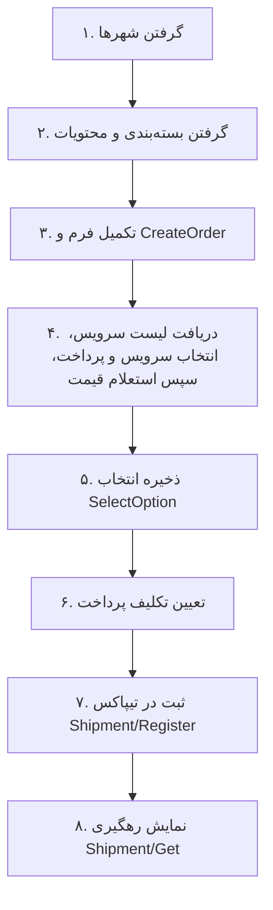

# راهنمای قدم‌به‌قدم ثبت سفارش برای فرانت

این بخش را به ترتیب پیاده کنید. برای هر قدم، سرویس، ورودی، خروجی کامل و کاربرد خروجی مشخص شده است.
اعداد و عنوان‌های مثال فرضی‌اند؛ همیشه از شناسه‌های واقعی پاسخ استفاده کنید.
سرویس‌های مدیریتی در انتهای فایل جدا آمده‌اند.

## وضعیت عمومی سفارش و وضعیت شرکت حمل

**وضعیت اصلی لیست سفارش‌ها** فقط `status` و `statusName` در خروجی `POST /api/Order/GetOrders` است. این دو از وضعیت عمومی لاجی‌وال می‌آیند؛ از وضعیت پرداخت یا فیلد قدیمی `Shipment.state` عنوان سفارش نسازید.

فهرست عمومی وضعیت‌ها:

```http
GET /api/Common/GetOrderStatuses
```

بدون توکن و Body. خروجی کامل فعلی:

```json
{
    "data":  [
                 {
                     "id":  0,
                     "code":  "Draft",
                     "title":  "تکمیل نشده"
                 },
                 {
                     "id":  10,
                     "code":  "Registered",
                     "title":  "ثبت شده"
                 },
                 {
                     "id":  12,
                     "code":  "AwaitingPickup",
                     "title":  "در انتظار جمع‌آوری"
                 },
                 {
                     "id":  13,
                     "code":  "Collected",
                     "title":  "جمع‌آوری‌شده"
                 },
                 {
                     "id":  14,
                     "code":  "OriginTransit",
                     "title":  "در مسیر مبدا"
                 },
                 {
                     "id":  15,
                     "code":  "Processing",
                     "title":  "در حال پردازش"
                 },
                 {
                     "id":  16,
                     "code":  "AtDestination",
                     "title":  "رسیده به شهر مقصد"
                 },
                 {
                     "id":  17,
                     "code":  "ReturningToPreviousNode",
                     "title":  "در حال برگشت به مرکز قبلی"
                 },
                 {
                     "id":  18,
                     "code":  "ReturningToSender",
                     "title":  "در حال عودت به فرستنده"
                 },
                 {
                     "id":  19,
                     "code":  "ReturnedToSender",
                     "title":  "عودت تحویل فرستنده شد"
                 },
                 {
                     "id":  20,
                     "code":  "Delivered",
                     "title":  "تحویل موفق به گیرنده"
                 },
                 {
                     "id":  21,
                     "code":  "Cancelled",
                     "title":  "لغوشده"
                 },
                 {
                     "id":  22,
                     "code":  "Invalidated",
                     "title":  "باطل‌شده"
                 }
             ],
    "succuss":  true,
    "message":  ""
}
```

در فیلتر `GetOrders`، مقدار فیلد `status` همین شناسهٔ عمومی است؛ مثلاً 20 برای تحویل موفق. شناسه‌های قدیمی پرداخت را برای فیلتر وضعیت سفارش استفاده نکنید. ترتیب پیش‌فرض لیست تاریخ ایجاد نزولی و سپس شناسه نزولی است.

### فیلتر لیست سفارش با شناسهٔ عمومی وضعیت

عنوان `title` را در انتخاب‌گر وضعیت نمایش دهید و **عدد `id` همان عضو** را بفرستید؛ نه متن عنوان و نه رشتهٔ code مثل Delivered. وضعیت صفر هم معتبر است و نباید به‌عنوان مقدار خالی حذف شود.

```http
POST /api/Order/GetOrders
Authorization: Bearer <LogiwallAccessToken>
Content-Type: application/json
```

نمونهٔ دریافت سفارش‌های تحویل موفق با id=20:

```json
{
  "hasPagination": true,
  "pageNumber": 1,
  "pageSize": 10,
  "filterGroups": [{
    "logicalOperator": 60,
    "conditions": [{ "propertyName": "status", "value": 20, "operator": 50 }]
  }]
}
```

operator=50 یعنی برابری، logicalOperator=60 یعنی AND. برای حذف فیلتر وضعیت، شرط status را حذف کنید؛ برای حذف همهٔ فیلترها `filterGroups: []` بفرستید. بعد از تغییر فیلتر صفحه را به 1 برگردانید.

خروجی GetOrders همان `{ data: { totalCount, result: [...] }, succuss, message }` است. `result[].status` همان id فهرست عمومی و `result[].statusName` عنوان عمومی آن است.

### وضعیت دقیق شرکت حمل در جزئیات

```http
GET /api/Shipment/Get?orderId=123
Authorization: Bearer <LogiwallAccessToken>
```

در بخش «وضعیت در شرکت پستی»، **خود `data.courierStatus`** را نمایش دهید؛ برای هر بسته هم `parcels[].courierStatus`. این عنوان اصلی شرکت است و نباید با عنوان عمومی لاجی‌وال جایگزین شود. مثلاً کد تیپاکس 50 عنوان «تحویل به گیرنده» دارد، ولی وضعیت عمومی ما id=20 و عنوان «تحویل موفق به گیرنده» است.

فیلدهای مرتبط در data، برای نمونه:

```json
{
  "courierStatusCode": "50",
  "courierStatus": "تحویل به گیرنده",
  "operationState": "Registered",
  "parcels": [{
    "orderParcelId": 200,
    "courierTrackingCode": "EXAMPLE-BARCODE",
    "courierStatusCode": "50",
    "courierStatus": "تحویل به گیرنده",
    "mappedOrderStatus": 20,
    "mappedOrderStatusName": "تحویل موفق به گیرنده"
  }]
}
```

اگر وضعیت بسته‌ها متفاوت بود، courierStatusCode/courierStatus سطح مرسوله null می‌شود؛ وضعیت اصلی هر بسته را جدا نمایش دهید. operationState برای کنترل دکمه‌های ثبت/لغو است و عنوان وضعیت شرکت حمل نیست.

| کد تیپاکس | عنوان اصلی تیپاکس | شناسهٔ وضعیت ما | عنوان عمومی لاجی‌وال |
|---|---|---|---|
| 59 | ثبت اولیه | 10 | ثبت شده |
| 61 | در انتظار تایید | 10 | ثبت شده |
| 30 | در دست جمع آوری | 12 | در انتظار جمع‌آوری |
| 38 | جمع آوری شد | 13 | جمع‌آوری‌شده |
| 62 | در مسیر مبدا | 14 | در مسیر مبدا |
| 58 | در حال پردازش | 15 | در حال پردازش |
| 60 | رسیدن به شهر مقصد | 16 | رسیده به شهر مقصد |
| 52 | برگشت خورد | 17 | در حال برگشت به مرکز قبلی |
| 51 | عودت شد | 18 | در حال عودت به فرستنده |
| 63 | مختومه عودتی | 19 | عودت تحویل فرستنده شد |
| 50 | تحویل به گیرنده | 20 | تحویل موفق به گیرنده |
| 57 | لغو شد | 21 | لغوشده |
| 34 | ابطال شد | 22 | باطل‌شده |

قبل از پذیرش موفق در شرکت حمل، وضعیت عمومی فقط «تکمیل نشده» با id=0 است؛ ذخیرهٔ فرم، استعلام، انتخاب قیمت، خطای ثبت و عملیات ثبت در جریان، وضعیت عمومی جدا ندارند. ثبت و تأیید یک وضعیت عمومی با id=10 هستند. وضعیت اصلی 61 تیپاکس حفظ می‌شود ولی به همان ثبت شده نگاشت می‌شود.

در `Shipment/Get`، `courierStatusCode` و `courierStatus` وضعیت اصلی شرکت حمل هستند؛ در `parcels[]` هم وضعیت اصلی هر بسته و `mappedOrderStatus` و `mappedOrderStatusName` معادل عمومی آن برمی‌گردد. اگر بسته‌ها وضعیت‌های متفاوت داشته باشند، وضعیت شرکت در سطح مرسوله null است؛ جزئیات هر بسته را نمایش دهید.

`operationState` فقط وضعیت فنی درخواست ثبت/لغو است و برای فعال/غیرفعال‌کردن دکمه‌ها کاربرد دارد. `state` نام قدیمی همین فیلد است و برای سازگاری باقی مانده؛ وضعیت اصلی سفارش یا وضعیت حمل نیست. کدهای جدید و بدون نگاشت شرکت حفظ می‌شوند و آخرین وضعیت عمومی معتبر باقی می‌ماند؛ معادل حدسی ساخته نمی‌شود.

در سفارش چندبسته‌ای، تنها وقتی همهٔ بسته‌ها Delivered باشند، سفارش «تحویل موفق» می‌شود. تا آن زمان مرحلهٔ بسته‌های باقیمانده مبنای وضعیت عمومی است؛ جزئیات هر بسته جدا نشان داده می‌شود. عنوان‌های «تحویل بخشی از بسته‌ها» و «وضعیت متفاوت بسته‌ها» در فهرست عمومی نداریم.

## ترتیب کار



قدم‌های ۱ و ۲ می‌توانند هم‌زمان اجرا شوند. **CreateOrder فقط سفارش داخلی را ذخیره می‌کند؛ ثبت در تیپاکس در قدم ۷ انجام می‌شود.**

آدرس پایهٔ لوکال معمولاً `http://localhost:5030` است. همهٔ درخواست‌ها به بک‌اند لاجی‌وال ارسال می‌شوند.
به‌جز سرویس شهرها، هدر `Authorization: Bearer <LogiwallAccessToken>` لازم است.
برای POST، `Content-Type: application/json` بفرستید. نام فیلد موفقیت در پاسخ واقعاً `succuss` است.

## قدم ۱ ـ شهر مبدا و مقصد

**چه زمانی؟** هنگام بازشدن فرم یا جست‌وجوی شهر.

**سرویس‌ها:**

```http
GET /api/Common/GetStaticDatas?type=11
GET /api/Common/GetStaticDatas?type=12
```

**ورودی Query:** `type=11` برای مبدا، `type=12` برای مقصد. فیلد اختیاری `searchBy` برای جست‌وجوست؛ مثلاً `&searchBy=تهران`. Body ندارد.

**خروجی کامل نمونهٔ هر سرویس:**

```json
{
  "data": [{ "id": 2, "title": "تهران", "provinceTitle": "تهران" }],
  "succuss": true,
  "message": ""
}
```

**در فرانت:** `title` و در صورت نیاز استان را نمایش دهید. `id` انتخاب مبدا را در `originCity` و `id` انتخاب مقصد را در `destinationCity` نگه دارید.
لیست مبدا و مقصد جدا هستند؛ شناسهٔ یکی را جای دیگری استفاده نکنید. این سرویس توکن نمی‌خواهد.

## قدم ۲ ـ بسته‌بندی و محتویات هر بسته

**چه زمانی؟** هنگام ورود به فرم مشخصات بسته.

### ۲.۱ نوع بسته‌بندی

**سرویس:**

```http
GET /api/Shipment/References?providerCode=tipax&category=packaging
```

**ورودی Query:** `providerCode=tipax` و `category=packaging`. Body ندارد.

**خروجی:**

```json
{
  "data": [{ "id": 15, "category": "packaging", "title": "عنوان بسته‌بندی از تیپاکس", "packType": 1 }],
  "succuss": true,
  "message": ""
}
```

**در فرانت:** `title` را در انتخاب‌گر بسته‌بندی نشان دهید؛ `id` انتخابی را در `packagingReferenceId` همان بسته ذخیره کنید.
`packType` اطلاعات تکمیلی است؛ آن را در ثبت سفارش ارسال نمی‌کنید و بک‌اند از بسته‌بندی انتخاب‌شده استخراجش می‌کند.

### ۲.۲ محتویات بسته

**سرویس:**

```http
GET /api/Shipment/References?providerCode=tipax&category=content
```

**ورودی Query:** `providerCode=tipax` و `category=content`. Body ندارد.

**خروجی:**

```json
{
  "data": [{ "id": 21, "category": "content", "title": "عنوان محتویات از تیپاکس", "packType": null }],
  "succuss": true,
  "message": ""
}
```

**در فرانت:** `title` را در انتخاب‌گر محتویات نشان دهید؛ `id` انتخابی را در `contentReferenceId` همان بسته ذخیره کنید.

هر بسته انتخاب‌های خودش را دارد؛ نیاز به بسته‌بندی و محتویات را برای هر بسته جدا نگه دارید.
اگر لیست خالی است، ادامهٔ فرم را متوقف کنید و پیام آماده‌نبودن اطلاعات پایه بدهید؛ مدیر باید همگام‌سازی کند.
این شناسه‌ها داخلی‌اند؛ کد مستقیم تیپاکس یا مقدار ثابت جای آن‌ها نگذارید.

### ۲.۳ کاربر خدمات بسته‌بندی نمی‌خواهد

در CreateOrder و UpdateOrder برای بسته‌ای که آمادهٔ ارسال است، `packageTypeId: 0` و `packagingReferenceId: null` بفرستید.
`contentReferenceId` همچنان الزامی است و از فهرست محتویات انتخاب می‌شود. سایر مشخصات بسته مانند وزن، ابعاد و ارزش کالا تغییر نمی‌کنند.

```json
{
  "parcelTypeId": 8,
  "packageTypeId": 0,
  "packagingReferenceId": null,
  "contentReferenceId": 52,
  "parcelValue": 4000000,
  "length": 20,
  "width": 15,
  "height": 10,
  "weight": 2.5,
  "cod": 0
}
```

شناسهٔ ۵۲ نمونه است؛ شناسهٔ واقعی محتویات را بفرستید. شناسهٔ بسته‌بندی صفر یا کد خارجی تیپاکس نفرستید.
بک‌اند رکورد فعال «نیاز به بسته‌بندی ندارد» را از شرکت انتخاب‌شده و مطابق `packType` محتویات پیدا می‌کند.
کد خارجی و نوع بسته در استعلام و ثبت نهایی یکسان می‌مانند. بدون بسته‌بندی به معنی حذف اطلاعات محتویات یا ابعاد نیست.

پاسخ `Shipment/References` برای دستهٔ packaging فیلد `requiresPackaging` دارد:
- `true`: خدمات بسته‌بندی؛ با `packageTypeId: 1` و `packagingReferenceId` انتخابی ارسال شود.
- `false`: گزینهٔ بدون خدمات بسته‌بندی؛ با `packageTypeId: 0` قابل استفاده است.
- برای دسته‌های دیگر مقدار این فیلد `null` است.

با انتخاب «بسته‌بندی نمی‌خواهم»، انتخاب قبلی بسته‌بندی را پاک کنید و انتخاب‌گر آن را مخفی کنید.
محتویات این حالت را با `packType` رکوردهای `requiresPackaging: false` فیلتر کنید؛ در دادهٔ فعلی تیپاکس انواع ۲۰ و ۶۰ هستند.
کدهای خارجی ۵۰۴ و ۵۲۱ فقط داخل بک‌اند نگاشت می‌شوند؛ فرانت آن‌ها را ثابت نکند.
در حالت نیاز به بسته‌بندی، فقط رکوردهای `requiresPackaging: true` را نمایش دهید و محتویات سازگار با `packType` انتخاب کنید.

اگر رکورد بدون بسته‌بندی سازگار موجود نباشد، استعلام با `ShippingNoPackagingUnavailable` خطا می‌دهد.
انتخاب متناقض یا ناسازگار با `ShippingPackagingIncompatible` رد می‌شود؛ خطا در `payload.details[].name` فیلد مربوط را مشخص می‌کند.
بعد از تغییر فرم، همان سفارش را UpdateOrder کنید و دوباره استعلام بگیرید؛ قیمت قبلی قابل استفاده نیست.

### ۲.۴ دریافت گزینه‌های سازگار از خود سرویس

فیلترهای زیر در Query سرویس References اختیاری‌اند؛ نام دسته تعیین می‌کند کدام فیلتر قابل استفاده است.
همهٔ شناسه‌ها داخلی لاجی‌وال هستند. فیلتر بر اساس `packType` اطلاعات فعال همان شرکت انجام می‌شود.

| فیلتر | کاربرد |
|---|---|
| `packageTypeId=0` | فقط گزینه‌های سازگار با بدون خدمات بسته‌بندی |
| `packageTypeId=1` | فقط گزینه‌های سازگار با خدمات بسته‌بندی |
| `packagingReferenceId` | فقط همراه `category=content`؛ محتویات سازگار با بسته‌بندی انتخابی |
| `contentReferenceId` | فقط همراه `category=packaging`؛ بسته‌بندی‌های سازگار با محتویات انتخابی |

**کاربر بسته‌بندی نمی‌خواهد:**

```http
GET /api/Shipment/References?providerCode=tipax&category=content&packageTypeId=0
```

پاسخ فقط محتویاتی را دارد که با حداقل یک رکورد فعال بدون بسته‌بندی سازگارند؛ «عمومی فلایر» نوع ۵۰ در آن نیست.
در فرم `packagingReferenceId=null` بگذارید و `contentReferenceId` را از همین پاسخ انتخاب کنید.

**کاربر ابتدا بسته‌بندی را انتخاب کرده است:**

```http
GET /api/Shipment/References?providerCode=tipax&category=content&packageTypeId=1&packagingReferenceId=17
```

شناسهٔ ۱۷ نمونه است. پاسخ فقط محتویات هم‌نوع با بسته‌بندی انتخابی را دارد.
`packagingReferenceId` بدون `packageTypeId` نیز پشتیبانی می‌شود؛ در صورت ارسال هر دو، انتخاب‌ها باید سازگار باشند.

**کاربر ابتدا محتویات را انتخاب کرده است:**

```http
GET /api/Shipment/References?providerCode=tipax&category=packaging&contentReferenceId=82&packageTypeId=1
```

شناسهٔ ۸۲ نمونه است. برای بررسی گزینه‌های بدون بسته‌بندی همان محتویات، `packageTypeId=0` بفرستید.
با حذف `packageTypeId`، همهٔ بسته‌بندی‌های سازگار شامل گزینه‌های بدون بسته‌بندی برمی‌گردند.

ساختار پاسخ تغییر نکرده است؛ نمونهٔ پاسخ محتویات سازگار با حالت بدون بسته‌بندی:

```json
{
  "data": [{
    "id": 83,
    "category": "content",
    "title": "عمومی",
    "packType": 20,
    "externalCode": "9",
    "mappedOrderStatus": null,
    "requiresPackaging": null
  }],
  "succuss": true,
  "message": ""
}
```

مقادیر نمونه‌اند؛ همیشه شناسهٔ واقعی پاسخ را استفاده کنید. لیست خالی `data: []` یعنی گزینهٔ فعال سازگار موجود نیست.
با تغییر بسته‌بندی یا انتخاب بدون بسته‌بندی، محتویات قبلی را پاک کنید و لیست را دوباره بگیرید.
این فیلترها فعلاً برای تیپاکس پشتیبانی می‌شوند. درخواست بدون فیلتر همچنان کل لیست را برمی‌گرداند.
شناسهٔ نامعتبر، غیرفعال یا متعلق به شرکت دیگر خطای ۴۰۰ می‌دهد. انتخاب متناقض نیز خطای ۴۰۰ دارد.
فیلتر بسته‌بندی/محتویات را به دسته‌های service یا status نفرستید؛ این ترکیب معتبر نیست.

## قدم ۳ ـ ذخیرهٔ فرم سفارش در لاجی‌وال

**چه زمانی؟** پس از تکمیل مشخصات فرستنده، گیرنده، آدرس‌ها و بسته‌ها.

**سرویس:** `POST /api/Order/CreateOrder`

**ورودی Body کامل:**

```json
{
  "channelId": 2,
  "senderName": "علی",
  "senderLastName": "احمدی",
  "senderPhoneNumber": "09123456789",
  "originCity": 2,
  "originLat": "35.6892",
  "originLng": "51.3890",
  "originAddress": "تهران، خیابان نمونه، ساختمان نمونه",
  "originPostalCode": "1234567890",
  "originalPlaque": "10",
  "originalUnit": "2",
  "receiverName": "رضا",
  "receiverLastName": "محمدی",
  "receiverPhoneNumber": "09123456780",
  "destinationCity": 120,
  "destinationLat": "37.2808",
  "destinationLng": "49.5832",
  "destinationAddress": "رشت، خیابان نمونه، ساختمان نمونه",
  "destinationPostalCode": "1234567891",
  "destinationPlaque": "20",
  "destinationUnit": "1",
  "description": "توضیحات سفارش",
  "orderParcels": [{
    "parcelTypeId": 8,
    "packageTypeId": 1,
    "packagingReferenceId": 15,
    "contentReferenceId": 21,
    "parcelValue": 4000000,
    "length": 20,
    "width": 15,
    "height": 10,
    "weight": 2.5,
    "cod": 0
  }]
}
```

**فیلدهای مهم:**

| فیلد | مقدار از کجا می‌آید؟ |
|---|---|
| `originCity` / `destinationCity` | شناسهٔ شهرهای انتخابی قدم ۱ |
| `packagingReferenceId` | با `packageTypeId=1` شناسهٔ بسته‌بندی؛ با `packageTypeId=0` مقدار `null` مجاز است |
| `contentReferenceId` | شناسهٔ محتویات قدم ۲.۲، برای هر بسته |
| `parcelTypeId` | `7` پاکت، `8` بسته |
| `packageTypeId` | فیلد قبلی: `0` بدون بسته‌بندی، `1` نیاز به بسته‌بندی؛ همراه انتخاب جدید ارسال شود |
| `weight` | کیلوگرم، عدد مثبت؛ مثلاً `2.5` |
| `length` / `width` / `height` | سانتی‌متر، عدد مثبت |
| `parcelValue` | ارزش کالا، عدد صحیح مثبت؛ فرم فعلی بر مبنای ریال |
| `cod` | مبلغ وصول بابت کالا، صفر یا مثبت؛ با هزینهٔ حمل پس‌کرایه فرق دارد |
| مختصات | رشته با نقطهٔ اعشار؛ مثلاً `"35.6892"` |
| `originalPlaque` / `originalUnit` | پلاک و واحد مبدا؛ املای `original` را رعایت کنید |
| `channelId` | کانال برنامه؛ فرانت فعلی `2` ارسال می‌کند |

نام، نام خانوادگی، تلفن، آدرس، مختصات، پلاک و واحد هر دو طرف الزامی‌اند. حداقل یک بسته لازم است.
کدپستی، توضیحات و `destinationCountry` اختیاری‌اند. محدودیت طول فیلدها در بخش جزئیات پایین آمده است.
تبدیل ریال/تومان اضافه نکنید؛ تأیید واحد مالی تیپاکس هنوز جزو موارد راه‌اندازی است.

**خروجی:**

```json
{
  "data": { "orderId": 123, "orderNumber": "123456" },
  "succuss": true,
  "message": ""
}
```

**برای قدم بعد:** `data.orderId` را نگه دارید. تمام مراحل بعدی همین شناسه را می‌گیرند.
`orderNumber` شمارهٔ نمایشی است؛ آن را جای `orderId` نفرستید.

## ویرایش سفارش و تلاش دوباره بعد از خطا

**سرویس:** `POST /api/Order/UpdateOrder`

هدرهای Authorization و Content-Type مانند CreateOrder هستند. Body شامل **تمام فیلدهای CreateOrder قدم ۳** به‌علاوهٔ `orderId` است؛ این سرویس جایگزینی کامل فرم است، نه ویرایش چند فیلد. `orderParcels` نیز لیست کامل جدید بسته‌هاست؛ شناسهٔ بستهٔ قبلی ارسال نمی‌شود.

مثال: همان JSON کامل قدم ۳ را بفرستید و `"orderId": 123` را به ابتدای آن اضافه کنید.

خروجی موفق:

```json
{
  "data": { "orderId": 123, "orderNumber": "L000123" },
  "succuss": true,
  "message": ""
}
```

شناسه و شمارهٔ سفارش تغییر نمی‌کنند. بعد از ویرایش، قیمت‌ها و انتخاب قبلی باطل‌اند: در فرانت هم آن‌ها را پاک کنید و دوباره GetOptions، سپس SelectOption و Register را برای **همان orderId** بزنید. CreateOrder جدید نزنید.

تا پیش از ثبت موفق در شرکت حمل، استعلام چندباره مجاز است؛ هر پاسخ جدید، قیمت‌ها و انتخاب قبلی را جایگزین می‌کند. پرداخت یا انتخاب قیمت، به‌تنهایی ثبت نهایی مرسوله نیست.

در حالت `Rejected`، کاربر می‌تواند اطلاعات را اصلاح کند، دوباره استعلام بگیرد و با اقدام خودش Register کند. تاریخچهٔ تلاش‌های قبلی حفظ می‌شود. در `Registered` و مرسوله‌ای که قبلاً ثبت و سپس لغو شده، ویرایش و استعلام مجدد مجاز نیست.
در `Submitting` یا `Unknown` پاسخ 409 می‌گیرید؛ ابتدا وضعیت را با Shipment/Get بررسی کنید. ارسال مجدد خودکار ممنوع است چون ممکن است درخواست قبلی واقعاً در شرکت حمل ثبت شده باشد.
اگر فرم هنگام استعلام تغییر کرده باشد، قیمت قدیمی ذخیره نمی‌شود و با `ShippingOrderChanged` باید برای اطلاعات جدید دوباره استعلام بگیرید.

## قدم ۴ ـ دریافت قیمت و گزینه‌های ارسال

در این مرحله ابتدا **نوع سرویس حمل** و **روش پرداخت** را از لیست‌های جدا انتخاب کنید؛ سپس با دکمهٔ «استعلام قیمت» درخواست قیمت بفرستید.
لیست روش پرداخت مشترک با این سرویس عمومی دریافت می‌شود:

```http
GET /api/Common/GetPaymentMethods
```

```json
{
  "data": [
    { "id": 71, "title": "سمت فرستنده - پیش‌پرداخت" },
    { "id": 72, "title": "سمت گیرنده - نقدی" },
    { "id": 73, "title": "سمت گیرنده - پرداخت در محل" },
    { "id": 75, "title": "سمت فرستنده - پرداخت از کیف پول" },
    { "id": 77, "title": "سمت فرستنده - نقدی" }
  ],
  "succuss": true,
  "message": ""
}
```

این شناسه‌ها برای تمام شرکت‌ها مشترک‌اند؛ کد پرداخت خارجی فقط در آداپتور شرکت نگاشت می‌شود.
روش‌های اعتباری (74، 78) و پرداخت در محل از کیف پول (76) نمایش داده نمی‌شوند و استعلام آن‌ها رد می‌شود.
کدهای تیپاکس روش‌های فعال به‌ترتیب 10، 20، 30، 50، 80 هستند؛ فرانت باید شناسه‌های لاجی‌وال 71، 72، 73، 75، 77 را بفرستد.
برای روش‌های غیرآنلاین، درخواست با همان روش انتخاب‌شده به تیپاکس ارسال می‌شود
و پذیرش، موجودی کیف پول یا اعتبار و قواعد آن روش توسط تیپاکس بررسی می‌شوند. ثبت مرسوله، پرداخت آنلاین لاجی‌وال را موفق اعلام نمی‌کند.
**سرویس جداگانهٔ دریافت نوع سرویس حمل:**

```http
GET /api/Shipment/Services?providerCode=tipax
Authorization: Bearer <LogiwallAccessToken>
```

بدون Body؛ ورودی Query، کد شرکت پستی است. نمونهٔ خروجی:

```json
{
  "data": [{ "id": 100, "category": "service", "title": "اکسپرس", "packType": null }],
  "succuss": true,
  "message": ""
}
```

این لیست برای استعلام لازم نیست. فقط برای قیمت یک سرویس خاص، `id` آن را در `serviceReferenceId` بفرستید.
عدد 100 فرضی است؛ شناسهٔ واقعی لیست را بفرستید، نه کد خارجی تیپاکس.

**سرویس استعلام قیمت:**

```http
GET /api/Order/GetOptions?orderId=123&paymentType=72
```

| ورودی Query | منبع مقدار |
|---|---|
| `orderId` | خروجی ایجاد سفارش |
| `paymentType` | `data[].id` انتخاب‌شده از `Common/GetPaymentMethods`؛ یکی از 71، 72، 73، 75، 77 |
| `serviceReferenceId` | اختیاری. نفرستید تا همهٔ سرویس‌ها قیمت‌گذاری شوند. با مقدار، فقط همان سرویس از `Shipment/Services` قیمت‌گذاری می‌شود |

Body ندارد. بدون `serviceReferenceId`، بک‌اند **همهٔ سرویس‌های فعال** را با روش پرداخت ارسالی قیمت‌گذاری می‌کند.
فقط سرویس‌هایی برمی‌گردند که تیپاکس این مرسوله را در آن‌ها می‌پذیرد؛ ارزان‌ترین اول.
مثلاً سرویس‌های «همان روز» و «اکسپرس هوایی» نوع بسته‌بندی 60 را نمی‌پذیرند و در پاسخ نیستند.
اگر هیچ سرویسی قیمت ندهد، خطای 400 با پیام `ProviderServiceUnavailable` برمی‌گردد.
با `serviceReferenceId`، ردِ تیپاکس با پیام خودش برمی‌گردد؛ ردِ «سگمنت» با پیام `ShippingServiceParcelTypeUnsupported` برمی‌گردد.
گرفتن لیست‌ها یا تغییر انتخاب‌ها به‌تنهایی استعلام قیمت نمی‌زند؛ فراخوانی قیمت با انتخاب روش پرداخت توسط کاربر انجام می‌شود.

**خروجی:**

```json
{
  "data": [{
    "providerId": 2,
    "providerName": "تیپاکس",
    "orderOptions": [{
      "id": 501,
      "serviceTitle": "ارسال زمینی سه روزه",
      "paymentType": 72,
      "delivereDate": "",
      "baseAmount": 150000,
      "packageAmount": 0,
      "pickupAmount": 0,
      "taxAmount": 0,
      "totalAmount": 150000
    }]
  }],
  "succuss": true,
  "message": ""
}
```

**در فرانت:** هر عضو `orderOptions` یک سرویس است. `serviceTitle`، شرکت و مبلغ نهایی هر گزینه را نمایش دهید.
کاربر یکی را انتخاب می‌کند و `id` آن به قدم ۵ می‌رود. انتخاب زمان جمع‌آوری نداریم.

مبلغ‌ها ریال هستند و سرور قیمت تیپاکس را به بالا تا مضرب ۱٬۰۰۰ ریال گرد می‌کند (مثلاً 10395953.649 → 10396000). همان عدد را نمایش دهید و گرد نکنید؛ پرداخت آنلاین همین مبلغ را می‌گیرد.
قیمت ۱۵ دقیقه اعتبار دارد؛ زمان انقضا فعلاً در پاسخ نیست و سرور آن را کنترل می‌کند.
با استعلام مجدد ID گزینه‌ها تغییر می‌کند و انتخاب قبلی باید پاک شود.

## قدم ۵ ـ ذخیرهٔ انتخاب کاربر

**سرویس:** `POST /api/Order/SelectOption`

**ورودی Body:**

```json
{
  "orderId": 123,
  "orderInqueryOptionId": 501
}
```

`orderInqueryOptionId` همان `data[].orderOptions[].id` قیمت تأییدشده در قدم ۴ است. ورودی زمان جمع‌آوری وجود ندارد.

**خروجی:**

```json
{
  "data": {
    "pickupOptions": [{
      "id": 501,
      "paymentType": 72,
      "providerPickupOptionId": null,
      "finalAmount": 150000,
      "basePrice": 150000,
      "itemPrice": 0,
      "tax": 0,
      "description": ""
    }]
  },
  "succuss": true,
  "message": ""
}
```

**برای پرداخت آنلاین:** `data.pickupOptions[0].id` را با نام `pickupOptionId` در قدم بعد ارسال کنید.
نام‌های `pickupOptions` و `pickupOptionId` از قرارداد قبلی باقی مانده‌اند و فقط شناسهٔ گزینهٔ قیمت هستند؛ به زمان جمع‌آوری ارتباطی ندارند.
در خطای انقضای قیمت، در صورت مجازبودن دوباره استعلام بگیرید.

## قدم ۶ ـ پرداخت: دو مسیر

### الف ـ روش‌های تسویه توسط تیپاکس: 72 تا 78

اگر روش پرداخت استعلام انتخاب‌شده یکی از 72 تا 78 است، بعد از SelectOption مستقیم به قدم ۷ بروید.
بک‌اند روش عمومی ذخیره‌شده روی استعلام را به روش پرداخت شرکت پستی تبدیل می‌کند؛ تنظیم جداگانهٔ پس‌کرایه در env لازم نیست.
این روش‌ها را به SelectPaymentType نفرستید. Register فقط `orderId` می‌گیرد و از روش ذخیره‌شده روی استعلام استفاده می‌کند.

### ب ـ آنلاین

**سرویس:** `POST /api/Order/SelectPaymentType`

**ورودی Body:**

```json
{
  "paymentType": 71,
  "orderId": 123,
  "pickupOptionId": 501,
  "channel": "pwa",
  "callbackUrl": "https://your-frontend.example/payment-result"
}
```

`pickupOptionId` از خروجی قدم ۵ است. callbackUrl آدرس واقعی برگشت فرانت است و باید با تنظیم سرور سازگار باشد.
برای این مسیر، استعلام قدم ۴ باید با paymentType=71 گرفته شده باشد. نمی‌توان برای استعلام پس‌کرایه لینک پرداخت آنلاین ساخت.

**خروجی نمونه:**

```json
{
  "data": {
    "requestId": 987,
    "referenceCode": "00000000-0000-0000-0000-000000000001",
    "paymentLink": "https://gateway.example/payment"
  },
  "succuss": true,
  "message": "پیام ایجاد لینک پرداخت"
}
```

کاربر را به `data.paymentLink` منتقل کنید. پس از برگشت، `POST /api/Payment/VerifyPayment` با Body زیر فراخوانی می‌شود:

```json
{ "orderId": 123 }
```

**محدودیت فعلی:** تأیید پرداخت SEP هنوز ناقص است. برای پرداخت جدید، خروجی موفق واقعی قابل اتکا نداریم.
مسیر آنلاین تا تأیید واقعی پرداخت در بک‌اند به ثبت تیپاکس نمی‌رسد؛ برگشت از درگاه به‌تنهایی مجوز ثبت نیست.

## قدم ۷ ـ ثبت واقعی در تیپاکس

**سرویس:** `POST /api/Shipment/Register`

**ورودی Body:**

```json
{ "orderId": 123 }
```

مشخصات بسته، آدرس و مبلغ را دوباره نمی‌فرستید؛ بک‌اند از استعلام انتخاب‌شده استفاده می‌کند.

**خروجی:**

```json
{
  "data": {
    "id": 10,
    "orderId": 123,
    "providerCode": "tipax",
    "state": "Registered",
    "operationState": "Registered",
    "courierStatusCode": "59",
    "courierStatus": "ثبت اولیه",
    "externalOrderId": "98765",
    "registeredAt": "2026-11-05T10:00:00+00:00",
    "parcels": [{
      "orderParcelId": 200,
      "courierTrackingCode": "EXAMPLE-BARCODE",
      "courierStatusCode": "59",
      "courierStatus": "ثبت اولیه",
      "mappedOrderStatus": 10,
      "mappedOrderStatusName": "ثبت شده"
    }]
  },
  "succuss": true,
  "message": ""
}
```

**در فرانت:** کد رهگیری هر بسته از `parcels[].courierTrackingCode` نمایش داده شود.
`externalOrderId` شناسهٔ تیپاکس است؛ `id` شناسهٔ مرسولهٔ لاجی‌وال و `orderId` شناسهٔ سفارش اولیه است.
اگر courierTrackingCode خالی بود، «در انتظار کد رهگیری» نمایش دهید.
هنگام درخواست دکمه غیرفعال باشد و retry خودکار POST نگذارید. در خطای شبکه یا 409، وضعیت را با قدم ۸ بخوانید.

## قدم ۸ ـ نمایش وضعیت و رهگیری

**چه زمانی؟** هنگام بازشدن جزئیات سفارش، بعد از ثبت یا با دکمهٔ به‌روزرسانی.

**سرویس:** `GET /api/Shipment/Get?orderId=123`

**ورودی Query:** `orderId` اولیه؛ بدون Body.

**خروجی:** همان پاسخ کامل قدم ۷. `operationState` وضعیت عملیات ثبت/لغو و `courierStatusCode` و `courierStatus` وضعیت اصلی شرکت حمل هستند. `parcels[]` وضعیت اصلی و معادل عمومی هر بسته را دارد.
این دو را با وضعیت پرداخت یکی نکنید.

| `operationState` | معنی | رفتار فرانت |
|---|---|---|
| `Prepared` | آمادهٔ پردازش | ثبت خودکار نکنید |
| `Submitting` | عملیات در جریان | ثبت و لغو غیرفعال |
| `Registered` | ثبت‌شده | نمایش کد رهگیری و وضعیت هر بسته |
| `Unknown` | نتیجه نیاز به بررسی دارد | ثبت مجدد نکنید؛ بررسی پشتیبانی لازم است |
| `Rejected` | ثبت پذیرفته نشد | نمایش خطا؛ ویرایش، استعلام مجدد و تلاش دوباره با اقدام کاربر |
| `Cancelled` | لغوشده | ثبت جایگزین خودکار نکنید |

404 یعنی مرسوله‌ای برای این سفارش در دسترس کاربر نیست. وضعیت حمل فعلاً از وب‌هوک تیپاکس به بک‌اند می‌رسد.

### صفحهٔ رهگیری مرسوله با کد رهگیری

**چه زمانی؟** کاربر واردشده کد رهگیری را در صفحهٔ «رهگیری مرسوله» می‌زند. فرانت دیگر مستقیم به تیپاکس (jet) درخواست نمی‌دهد و هیچ توکنی در فرانت نیست.

**سرویس:** `GET /api/Shipment/Track?providerCode=etipax&code=BA800197458IR`

**ورودی Query:** `providerCode` کد شرکت حمل (فعلاً فقط `etipax`). `code` کد رهگیری، ۵ تا ۴۰ حرف انگلیسی یا عدد؛ فاصلهٔ اول و آخر حذف می‌شود. تیپاکس کد ۲۱ رقمی و بارکد ۱۳ کاراکتری را می‌پذیرد.

**خروجی:** قرارداد برای همهٔ شرکت‌های حمل یکسان است. بک‌اند پاسخ هر شرکت را به این شکل تبدیل می‌کند:

```json
{
  "providerCode": "etipax", "providerName": "تیپاکس",
  "trackingCode": "BA800197458IR", "status": "ابطال شده", "serviceName": "اکسپرس",
  "registeredAt": "2026-11-07T12:36:15+03:30",
  "sender":   { "fullName": "…", "city": "تهران", "province": "تهران" },
  "receiver": { "fullName": "…", "city": "شیراز", "province": "فارس" },
  "journey": [
    { "title": "ابطال بسته", "occurredAt": "2026-11-07T12:38:10+03:30", "city": "تهران", "location": "فروش", "description": "درخواست مشتری" }
  ],
  "payment": { "method": "پس کرایه", "totalAmount": 10395953.65, "payOnDeliveryAmount": 10395953.65, "codAmount": 0 }
}
```

* `journey` از قدیمی به جدید مرتب است؛ آخرین مرحله آخرین عضو است. هر فیلد به‌جز `title` ممکن است `null` باشد.
* تاریخ‌ها ISO با منطقهٔ زمانی هستند؛ برای نمایش شمسی از `toLocaleString('fa-IR')` استفاده کنید.
* مبلغ‌ها ریال و همان مبلغ شرکت حمل هستند و گرد نمی‌شوند؛ ممکن است با مبلغ گردشدهٔ قدم ۴ کمی فرق کنند.
* شمارهٔ موبایل و نشانی فرستنده و گیرنده برگردانده نمی‌شود.

**خطاها:** 404 `ParcelTrackingNotFound` (کد در شرکت حمل پیدا نشد)؛ 400 `ShippingProviderUnavailable` (شرکت حمل نامعتبر یا غیرفعال)؛ 400 `ParcelTrackingCodeInvalid` (قالب کد)؛ 400 `ProviderServiceUnavailable` (شرکت حمل پاسخ نداد)؛ 401 بدون ورود؛ 429 بیش از ۲۰ درخواست در دقیقه برای هر کاربر.

## قدم ۹ ـ لغو، در صورت نیاز

**سرویس:** `POST /api/Shipment/Cancel`

**ورودی Body:**

```json
{ "orderId": 123 }
```

**خروجی:** همان پاسخ کامل قدم ۷ با `data.state = "Cancelled"` در صورت موفقیت.
فقط صاحب مرسولهٔ Registered با شناسهٔ خارجی می‌تواند لغو کند. این عملیات استرداد وجه انجام نمی‌دهد.
در نتیجهٔ نامشخص، Get بزنید و لغو را خودکار تکرار نکنید.

## خلاصهٔ انتقال مقدار بین سرویس‌ها

| خروجی | محل استفاده در ورودی بعدی |
|---|---|
| شهر مبدا `data[].id` | `CreateOrder.originCity` |
| شهر مقصد `data[].id` | `CreateOrder.destinationCity` |
| بسته‌بندی `data[].id` | `orderParcels[].packagingReferenceId` |
| محتویات `data[].id` | `orderParcels[].contentReferenceId` |
| `Shipment/Services.data[].id` | `GetOptions.serviceReferenceId` (اختیاری) |
| `Common/GetPaymentMethods.data[].id` | `GetOptions.paymentType` |
| `CreateOrder.data.orderId` | `orderId` همهٔ مراحل بعد |
| `GetOptions.data[].orderOptions[].id` | `SelectOption.orderInqueryOptionId` |
| `SelectOption.data.pickupOptions[0].id` | `SelectPaymentType.pickupOptionId` |
| `SelectPaymentType.data.paymentLink` | انتقال کاربر به درگاه |
| `Register.data.parcels[].courierTrackingCode` | نمایش رهگیری هر بسته |

## برخورد با خطا

خطای انتخاب بسته‌بندی یا محتویات، نام فیلد بسته را در `payload.details[].name` می‌دهد؛ مثلاً `orderParcels[0].packagingReferenceId`.
خطاهای داخلی فرم قرارداد فیلدی قبلی را دارند. خطای دریافتی از تیپاکس فقط `message` و `status` دارد؛ چند پیام تیپاکس در یک رشته جمع می‌شوند.

```json
{ "message": "وزن بسته برای سرویس انتخاب‌شده مجاز نیست.", "status": 422 }
```

کد HTTP با `status` برابر است. رد احراز هویت حساب تیپاکس 502 است؛ نتیجهٔ نامشخص ثبت یا لغو 409 است و باید با Shipment/Get بررسی شود. نمونهٔ زیر فقط برای اعتبارسنجی داخلی فرم است.

```json
{
  "exceptionType": "Logiwall.Shared.Exceptions.ResourceValidationException",
  "key": "ShippingPackagingRequired",
  "message": "نوع بسته‌بندی معتبر این بسته را انتخاب کنید.",
  "payload": {
    "resourceTypeName": "*",
    "details": [{
      "name": "orderParcels[0].packagingReferenceId",
      "errors": [{ "key": "ShippingPackagingRequired", "message": "نوع بسته‌بندی معتبر این بسته را انتخاب کنید." }]
    }]
  }
}
```

- 400: پیام فارسی سرور را نمایش دهید و فرم را حفظ کنید؛ در انقضای قیمت، استعلام مجدد در صورت مجازبودن.
- 401: جریان ورود مجدد؛ 403: نداشتن دسترسی؛ 404: سفارش یا مرسوله در دسترس نیست.
- 409 یا خطای شبکه در ثبت/لغو: وضعیت را با Shipment/Get بخوانید؛ ثبت مجدد خودکار نکنید.
- وجود `data` را در پاسخ خطا فرض نکنید؛ بدنهٔ خطای اعتبارسنجی و exception ممکن است متفاوت باشد.

## جزئیات تکمیلی قرارداد و سرویس‌های مدیریتی

## Operations endpoints: not part of the customer form

| Endpoint | Access / contract |
|---|---|
| `POST /api/Shipment/SynchronizeReferences` | AdminsOnly; no body; response data=true on success |
| `POST /api/Shipment/Webhook` | Carrier integration; requires X-Tipax-Webhook-Secret, not a frontend login token |

Webhook request: positive `parcelEventId` (64-bit), positive `parcelEventTypeId`, required `barcode` (max 100),
optional `eventTypeTitle` and `barcodeTitle` (max 200 each). Response `{ "received": true }`.
The browser never stores or sends the webhook secret.

## Sources and setup

- Controllers: `src/Logiwall.Server/Controllers/Order/ShipmentController.cs`, `OrderController.cs`, `PaymentController.cs`.
- DTOs: `src/Logiwall.Shared/Dtos/OrderItems/ShippingDtos.cs` and the existing order request/response DTOs.
- Server configuration and migration instructions: [setup.md](setup.md).
- Architecture: [ADR 0006](../../adr/0006-carrier-shipments-and-reference-data.md).
- Scope: shipping/order flow for cycle 020; identity, profile and other API modules keep their existing contracts.


کد رهگیری: تیپاکس هنگام ثبت موفق trackingCodes را برمی‌گرداند؛ بک‌اند آن را روی ShipmentParcels ذخیره می‌کند و Register و Shipment/Get در parcels[].courierTrackingCode برمی‌گردانند. در جزئیات، کد هر بسته را با عنوان «کد رهگیری تیپاکس» نمایش دهید. externalOrderId شناسهٔ سفارش شرکت است و جای کد رهگیری نیست؛ از فیلد قدیمی serviceProviderTrackingCode سفارش استفاده نکنید.

اطلاعات کامل صفحهٔ جزئیات فعلاً از دو پاسخ تأمین می‌شود: ردیف GetOrders برای نام و تلفن طرفین، مبدا/مقصد، آدرس، پلاک/واحد، کدپستی و مبالغ؛ Shipment/Get برای کد رهگیری و وضعیت اصلی شرکت. finalAmount هزینهٔ نهایی گزینهٔ انتخاب‌شده است. paidAmount مجموع VerifiedAmount پرداخت‌های موفق با VerifiedAt ثبت‌شده در لاجی‌وال است؛ پرداخت منتظر تأیید یا صرف صدور لینک در آن شمرده نمی‌شود. صفر یعنی مبلغ تأییدشده‌ای نزد لاجی‌وال ثبت نیست؛ وضعیت تسویهٔ پس‌کرایه/کیف پول شرکت حمل را اثبات نمی‌کند.

وضعیت پرداخت در هر ردیف GetOrders: paymentStatus کد رشته‌ای و paymentStatusName عنوان نمایشی است. فقط چهار مقدار دارد: Unpaid=پرداخت نشده، Paid=پرداخت شده، Failed=پرداخت ناموفق، PartiallyPaid=بخشی از مبلغ پرداخت شده. پرداخت در جریان یا تسویه با شرکت حمل بدون تأیید دریافت وجه، Unpaid است. در جزئیات هزینه فقط finalAmount، paidAmount و paymentStatusName نمایش داده شوند.

?? ????? POST /api/Order/GetOrders? ?? ???? serviceProviderTitle ?? ???? serviceProviderId ????? ????? serviceProviderTitle ????? ?????? ???. ?? ??? ?? ?????? ???? ???? ????? null ???.
