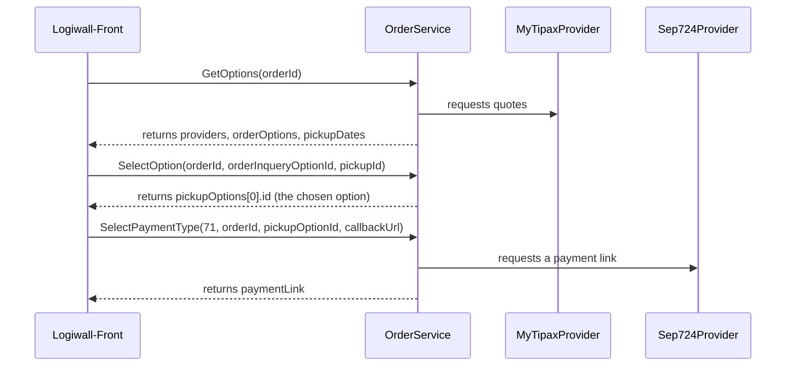

# QA: `GET api/Order/GetOptions?orderId=`

The endpoint asks each courier for quotes, replaces the stored options of the order, and returns
them. Cycle 019 (E2E C2, B2) changed the response to the front's shape (`IgetOptions` in
`Logiwall-Front/src/types/create-order.ts`).

The whole order flow:

Response `data`: one item for each provider.

| Field | Meaning |
|---|---|
| `providerId`, `providerName` | `ServiceProviders.Id`, `ServiceProviders.Title` |
| `orderOptions[]` | `id`, `delivereDate`, `baseAmount`, `packageAmount`, `pickupAmount`, `taxAmount`, `totalAmount` |
| `pickupDates[]` | `id` (`yyyy-MM-dd`), `description` (Persian date), `times[]` with `id` (`yyyy-MM-ddTHH`) and `description` |

## Acceptance criteria

1. The front's options page renders one slide for each provider.
2. `baseAmount` = MyTipax `shippingCost` + `specialService`. `baseAmount + packageAmount + taxAmount` = `totalAmount` when MyTipax's parts add up.
3. `pickupDates` has 3 days from tomorrow (Tehran time), without Fridays. Each day has the windows 9-12, 12-15 and 15-18.
4. `pickupAmount` is 0. No provider gives a pickup price.

## Positive scenarios

| # | Steps | Expected |
|---|---|---|
| P1 | Create an order. Call `GetOptions`. | 200, one provider with its options and 3 pickup dates |
| P2 | Call it twice. | The second call replaces the options. The count does not double. |

## Negative scenarios

| # | Steps | Expected |
|---|---|---|
| N1 | Another user's order | 400 `InvalidOrder` |
| N2 | An order in `PaymentPending` or `Paid` | 400 `OrderCannotBeRequoted` |
| N3 | All couriers fail | 400 `ProviderServiceUnavailable`. The old options stay. |

## Edge cases

* MyTipax leaves out `shippingCost` or `specialService`: that part counts as 0.
* MyTipax leaves out `finalAmount`: the quote fails with `ProviderServiceUnavailable`. A missing total never becomes a zero payment.
* A call at 23:59 and a call at 00:01 Tehran time give different `pickupDates`.

## Authorization and resource ownership

The order must belong to the token's customer (`t.Customer.Person.UserId == userId`).

## Validation

`orderId` binds from the query string.

## Concurrency and idempotency

The service locks the order row (`UPDLOCK, HOLDLOCK`), so two parallel calls leave one set of options.

## Failure scenarios

One courier down: the service logs a warning and skips it. All couriers down: N3.

## Integration considerations

* Not verified against a real MyTipax response: the meaning of `shippingCost` and `specialService` (ADR-0001, plan 010).
* The front selects `pickupDates[1].times[0]` by default. The front reads `activeSlide` only after a slide change.

Automated tests: `OrderQuoteFlowTests` (P1, P2, N3, parallel quotes), `PickupSlotsTests`.
